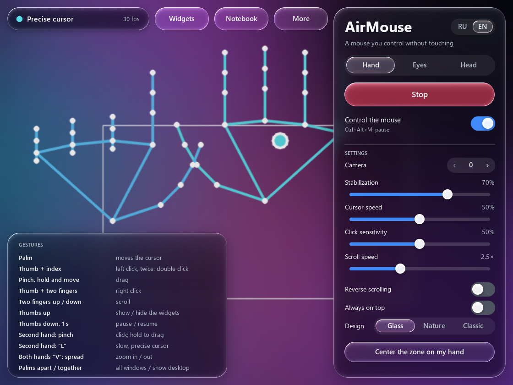
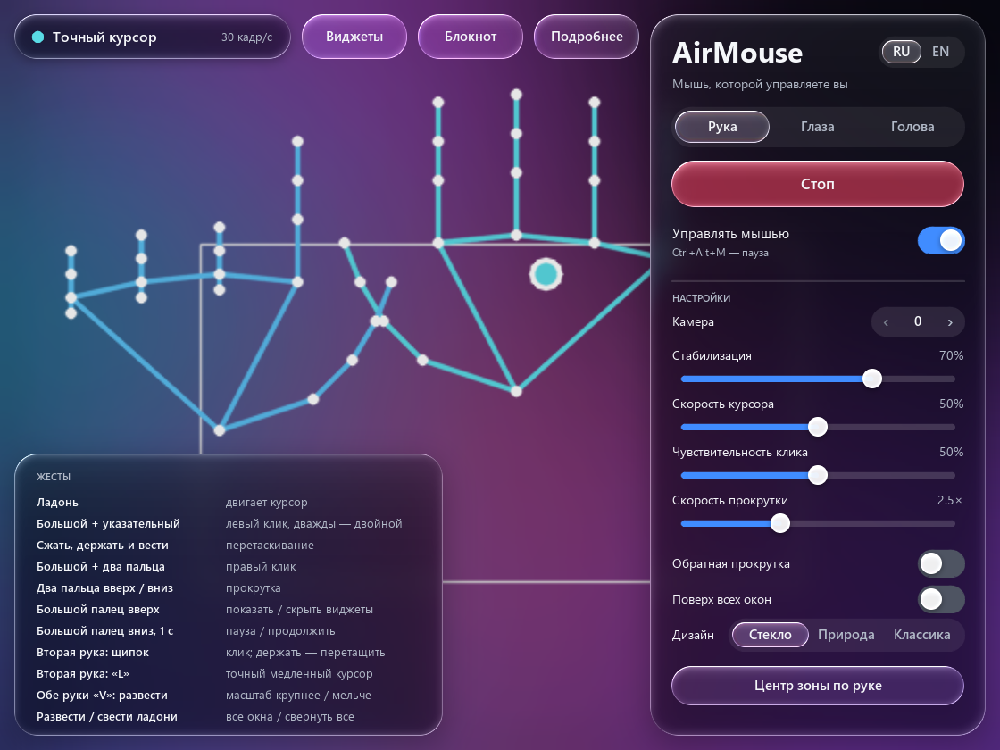
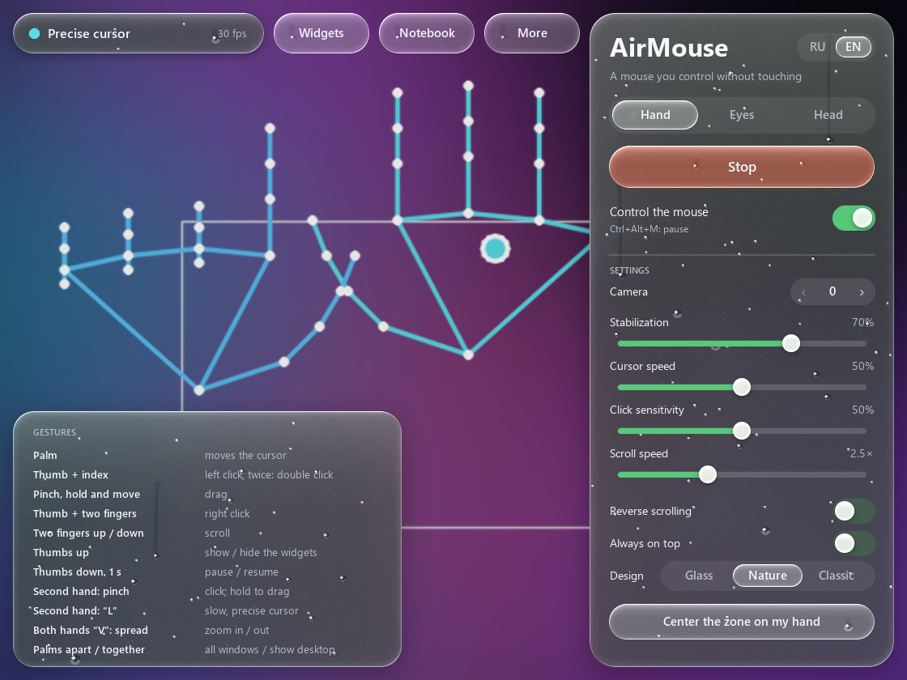
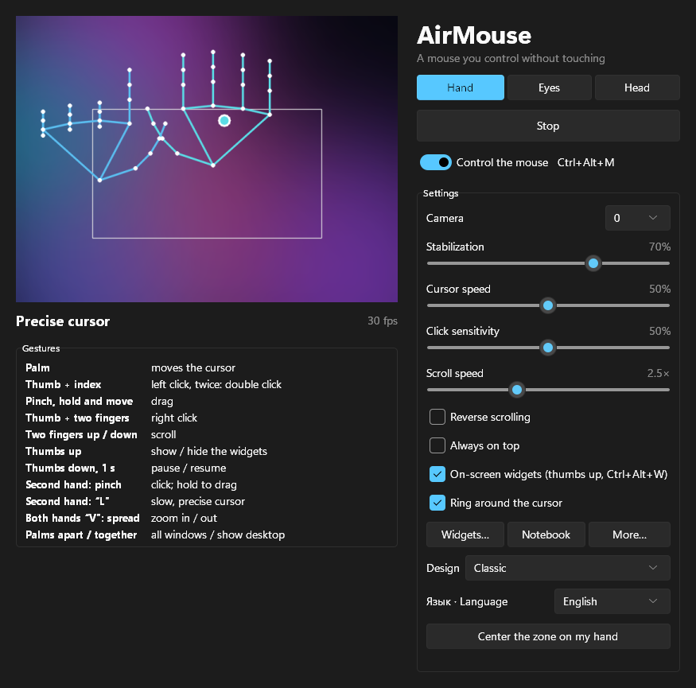
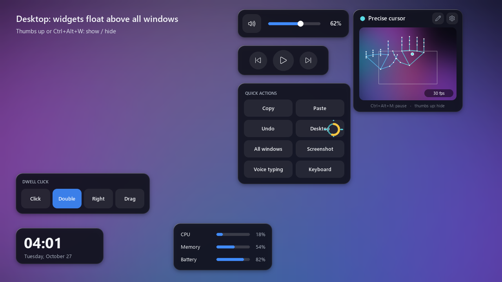
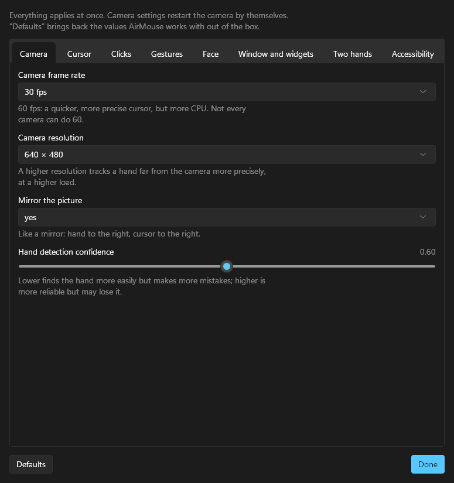
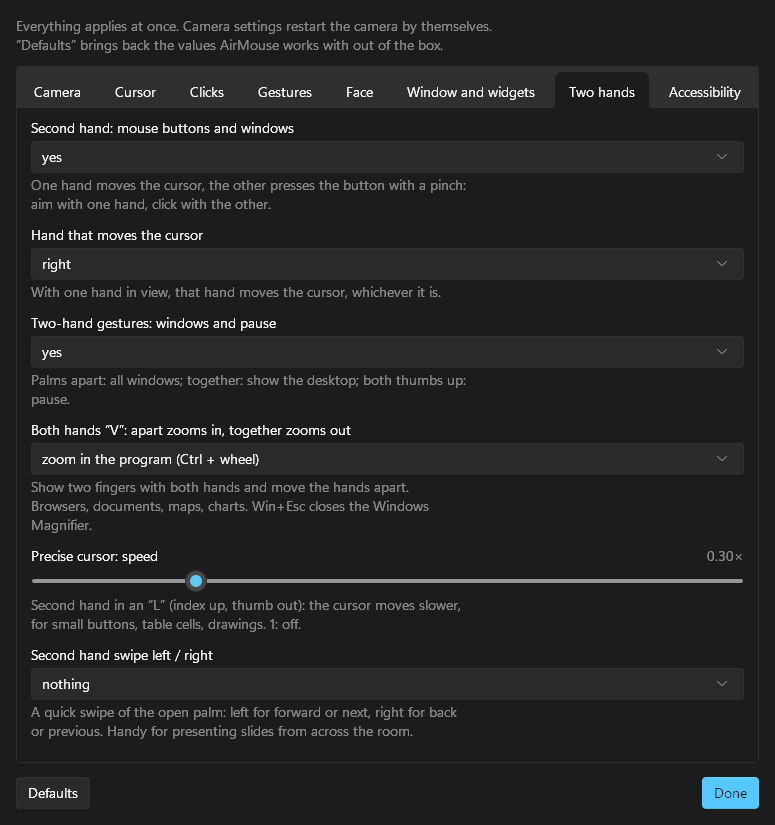
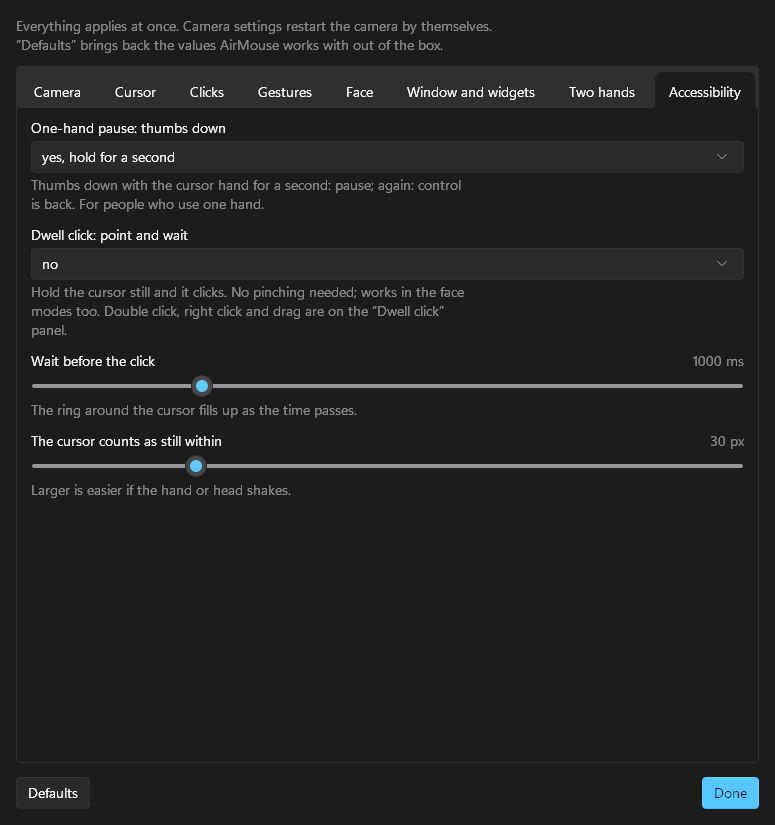

# AirMouse

[Русский](README.md) · **English**

Control the mouse in Windows and Linux through a webcam, without touching the computer: with one hand, with two hands, with your eyes or by turning your head.
Pick the mode with the **Hand / Eyes / Head** switch at the top of the window. The interface speaks English and Russian: the **RU | EN** switch.

**[Download AirMouse for Windows](https://github.com/Future-Web2/AirMouse/releases/latest/download/AirMouse-windows-x64.zip)** (zip, 83 MB). Extract the whole archive and run `AirMouse\AirMouse.exe`; no Python needed. All versions are on the [Releases](https://github.com/Future-Web2/AirMouse/releases) page.

**[Download for Linux](https://github.com/Future-Web2/AirMouse/releases/latest/download/AirMouse-linux-x64.tar.gz)** (tar.gz): how to install it is in the [Linux](#linux) section.

**How to use it:** [illustrated guide](docs/GUIDE.en.md).



## Getting started

You need Windows 10/11 or Linux (see [Linux](#linux)) and a webcam.

- **Build the program:** run `build.bat` (needs Python 3.12 or newer). It creates `.venv`, installs the dependencies, downloads the hand and face models if they are missing and builds `dist\AirMouse\AirMouse.exe`. Move the `dist\AirMouse` folder only as a whole. Build in a folder with a short path (for example `C:\src\AirMouse`): MediaPipe has long file paths, and in deep folders Windows will not load its libraries.
- **Run from source:** `.venv\Scripts\python.exe main.py`
- **Check:** `.venv\Scripts\python.exe -m unittest` runs the tests, `main.py --bench` measures the KPIs (see below).

Press **Start**: the camera and the control come on. **Ctrl+Alt+M** (or a thumbs down held for a second) pauses and resumes the control, **Ctrl+Alt+W** hides and shows the [on-screen widgets](#on-screen-widgets), **Ctrl+Alt+N** opens and closes the [notebook for drawing](#notebook-draw-by-hand).

## Linux

AirMouse runs on Linux too: under X11 and Wayland (GNOME, KDE Plasma and others).

**[Download AirMouse for Linux](https://github.com/Future-Web2/AirMouse/releases/latest/download/AirMouse-linux-x64.tar.gz)** (tar.gz, x86-64; Ubuntu 22.04, Debian 12, Fedora 36 or newer). GitHub Actions builds the archive on Ubuntu 22.04 and attaches it to the release.

```bash
tar -xzf AirMouse-linux-x64.tar.gz
cd AirMouse
./install.sh
./AirMouse
```

`install.sh` does two things:

1. adds AirMouse to the applications menu;
2. gives access to `/dev/uinput`, asking for your password: it installs the udev rule `99-airmouse-uinput.rules` and adds you to the `input` group.

Through `/dev/uinput` AirMouse moves the mouse and presses keys, the same under X11 and Wayland. Without it, under X11 the mouse still works through the XTEST extension; under Wayland AirMouse shows how to give access. If the mouse does not move right after `install.sh`, log out and back in. Only the menu entry, no password: `./install.sh --menu`.

The `/dev/uinput` device can press any key. The rule gives access only to the person at the computer and the `input` group, not to every program.

**From source:** Python 3.12 or newer with Tk (Debian, Ubuntu: `sudo apt install python3-venv python3-tk`). `./build.sh` builds `dist/AirMouse/AirMouse` and the archive `dist/AirMouse-linux-x64.tar.gz`. To run without building: `.venv/bin/python main.py`.

**How Linux differs from Windows:**

| | X11 | Wayland |
|---|---|---|
| Cursor, clicks, scrolling, zoom | yes | yes, through `/dev/uinput` |
| Ctrl+Alt+M, Ctrl+Alt+W, Ctrl+Alt+N | in any window | while an AirMouse window is active; the pause gesture always works |
| Maximize and minimize a window with the second hand | through the window manager | with the desktop's keys: Super+Up and Super+H (GNOME), Meta+PgUp and Meta+PgDown (KDE) |
| Show the desktop (palms together) | through the window manager | Super+D |
| All windows (palms apart) | Super in GNOME, Meta+W in KDE | the same |

- **On-screen widgets** are borderless windows above all others, with rounded corners but no soft shadow: without a compositor X11 cannot do see-through edges. The cursor ring lets clicks through with the SHAPE extension. Under Wayland the widgets run through XWayland.
- **Icons** on the widgets are ordinary font symbols (▶ ⚙ ✎): Linux has no Segoe Fluent icons, and fontconfig picks the font.
- **Volume:** through PipeWire (`wpctl`) or PulseAudio (`pactl`).
- **Copying a notebook page:** through `wl-copy` (Wayland) or `xclip` (X11).
- **On-screen keyboard:** the “Keyboard” button opens Onboard if it is installed. The “Desktop”, “All windows” and “Screenshot” buttons press the keys your desktop understands.
- **The two-hand screen magnifier** in GNOME has to be switched on once with Alt+Super+8.
- **The camera** opens through V4L2. The settings are in `~/.config/AirMouse/`.

The Linux version is checked by 25 tests with stand-ins for the kernel, X11 and programs, and the whole test suite and the model check run on Ubuntu in GitHub Actions. Nobody has tried this version on a real Linux desktop with a camera yet. If something does not work, please open an [issue](https://github.com/Future-Web2/AirMouse/issues) with your distribution, X11 or Wayland, and desktop.

## Language: English and Russian

The whole interface comes in both languages: the main window, the on-screen widgets, “More”, the widget editor, the gaze calibration and the error messages. The **RU | EN** switch sits next to the AirMouse title; in the classic design it is the **“Язык · Language”** row. The window reopens in the chosen language at once, and the camera keeps running.

On the first start AirMouse takes the language of Windows: Russian if Windows speaks Russian (or Belarusian, Kazakh, Kyrgyz, Tajik, Uzbek), English otherwise.

| English | Русский |
|---|---|
|  |  |

All interface texts are in one dictionary, `airmouse/i18n.py`, and the test `tests/test_i18n.py` checks that every Russian text has its English line, with the same numbers in place.

## Three designs

Pick the design in the settings, in the **Design** row: “Glass” / “Nature” / “Classic”. The window reopens in the new look at once. If the camera was on, it keeps running. The choice is remembered.

| Liquid Glass | Nature | Classic |
|---|---|---|
|  |  |  |

**Nature** is the same liquid glass, only fogged: it blurs and lightens what is behind it more, and drops of condensation with highlights and a few runs are scattered over it. Under the glass is a deep green backdrop with slow sunlight glints. The on-screen widgets turn green with drops in this design too.

**Classic** uses the standard Windows 11 controls (the Sun Valley theme), with the camera preview in its own box and a light or dark theme that follows the system.

### Liquid Glass

The camera fills the whole window, and the control panels float over it like glass:

- they blur the picture behind them and refract it at the edges, with a slight rainbow tint;
- the edges are lit as if light fell on the glass from the top left.

The mode switch is a glass drop that flows to the chosen item with a springy “liquid” animation. A slider knob turns into a clear lens while you drag it. While the camera is off, a colourful backdrop shimmers behind the glass.

The program draws the window entirely by itself (`airmouse/glass.py`, `airmouse/widgets.py`) and puts it on the screen directly through GDI (`airmouse/blit.py`). When AirMouse is not in front, the window updates less often: mouse control does not slow down, and the processor is spared.

## On-screen widgets

While AirMouse controls the mouse, widgets float above all windows. You use them by hand like any program: a pinch presses a button, “pinch and move” moves a slider or the widget itself, the scroll gesture over the volume changes it.



| Widget | What it does |
|---|---|
| AirMouse | The camera with the hand, what the program sees, fps. The pen opens the notebook, the gear opens the widget settings |
| Volume | The Windows volume slider, scrolling over it, a mute button |
| Music and video | Previous track, play or pause, next track |
| Button panel | Your own buttons: a key combination, or “open” a program, a file, a website |
| Clock | Time and date |
| Computer load | CPU, memory, battery |
| [Notebook](#notebook-draw-by-hand) | Pages to draw on by hand, like Paint |
| [Dwell click](#two-hands-and-accessibility) | What the next dwell click is: a click, a double click, a right click or a drag. Shown while the dwell click is on |

- **Show or hide:** hold a thumbs up for half a second or press **Ctrl+Alt+W**.
- **Widgets never take the focus.** The “Copy” button presses Ctrl+C in the program you are working in, and “Keyboard” opens the Windows on-screen keyboard, to type by hand.
- **Your own widgets.** The **“Widgets”** button in the AirMouse window (in the classic design, **“Widgets…”**) opens the editor. There you switch widgets on and make as many button panels as you like, with up to 12 buttons each. A button can press keys (`ctrl+c`, `win+d`, `alt+tab`, `ctrl+shift+esc`, `f5`, `playpause`, `volumeup`) or open a program (`notepad`, `calc`, `osk`), a website (`https://…`) or a file.
- **Widgets without the camera:** “More” → “Window and widgets” → “Widgets on screen even with the camera off”. The widget size is set there too.
- **The ring around the cursor** shows what AirMouse sees: it fills up while the fingers close (or the eyes stay shut), flashes on a click and shows arrows while scrolling. The mouse goes straight through the ring.
- The **“Session”** card in the AirMouse window shows the fps over the last minute, the CPU load and how many clicks and scrolls there were.

The widgets are AirMouse's own transparent windows (`airmouse/onscreen.py`, `airmouse/overlay.py`). The Windows 11 widget board (Win+W) only takes programs installed from a signed MSIX package (for example from the Microsoft Store), and AirMouse comes as an archive, so it cannot go there. AirMouse widgets live right on the screen: a thumbs up or **Ctrl+Alt+W**.

## Notebook: draw by hand

A scratch pad like Paint, above all windows: pinch on the paper and move the hand to draw a line, open the fingers to end it. With the mouse you draw the same way, holding the left button.

- **Open or close:** the **“Notebook”** button in the AirMouse window, the pen on the AirMouse mini panel (reachable by hand), **Ctrl+Alt+N**, or the cross on the notebook itself. The notebook shows even with the camera off; then you draw with the mouse.
- **Tools:** pen, thick marker, eraser and five colours. Picking a colour puts the eraser away.
- **Undo** takes back the last lines one by one; clearing the page can be undone too.
- **Pages:** “‹ ›” turn the pages, “+” adds a new one. Each page saves itself as a PNG picture a second after a change, in `%APPDATA%\AirMouse\notebook`, and opens again next time. The folder button opens that folder.
- **Copy** puts the page on the clipboard as a picture: paste it with Ctrl+V into a chat, a document or an email.
- The corner button makes the notebook nearly as big as the screen, to draw larger, and back.

A hand in the air shakes more than a mouse on a desk, so the lines come out a little uneven. It helps to move “Stabilization” to the right and to lower “More” → “Clicks” → “Movement that starts a drag” (for example to 10 px): then the line starts right after the pinch.

## “More”: fine-tuning

The **“More”** button opens 33 parameters on eight tabs: camera, cursor, clicks, gestures, face, window and widgets, two hands, accessibility. Each can be raised or lowered. Everything applies at once, camera settings restart the camera by themselves, and “Defaults” puts everything back. Only changed values are stored.



- **60 fps** (“Camera” → “Camera frame rate”): a more precise and responsive cursor, if the camera can do it. For 60 fps and 1280×720 AirMouse asks the camera for a compressed MJPG stream, otherwise many webcams do not give that speed. The real camera frame rate shows in the “Session” card.
- All gesture delays are in milliseconds, not frames, so the gestures work at 60 fps just as at 30.
- The rest: the cursor dead zone and response, the camera glitch filter, pinch and right-click timing, the scroll step, holding the thumbs up, the eye, mouth and brow thresholds, the window frame rate, the widget size.

What each parameter does, and ready recipes (“maximum precision”, “fewer accidental clicks” and more), are in the [guide](docs/GUIDE.en.md#7-more-fine-tuning).

## Hand gestures (“Hand” mode)

| Gesture | Action |
|---|---|
| Move the palm | Cursor |
| Touch the thumb to the index finger | Left click (twice in a row: double click) |
| Pinch, hold and move the hand | Drag |
| Touch the thumb to the index and middle fingers | Right click |
| Raise the index and middle fingers, fold the rest, move up / down | Scroll |
| Make a fist, thumb up, hold for half a second | Show or hide the widgets |
| Make a fist, thumb down, hold for a second | Pause; again: control is back (one hand, no keyboard) |

## Two hands and accessibility

AirMouse is made for people who find a mouse hard to use: after an injury, with weak or shaking hands, with one working hand or with no working hands at all. And for people who need precision without touching anything: scientists, engineers, designers, teachers at the board. You can share the work between two hands, click without bringing the fingers together at all, or control the mouse with the eyes and the head.

**Two hands.** With both hands in view, one moves the cursor and the other works as the mouse buttons. The right hand moves the cursor; change it in “More” → “Two hands”. Aiming and pressing are done by different hands, so the cursor does not slip at the moment of the click. The cursor hand can still do everything a single hand does.

| Second hand | What happens |
|---|---|
| Pinch (thumb + index) | Left button: down while the fingers touch. A quick pinch is a click, two are a double click. Hold the pinch and move the cursor with the other hand to drag |
| Thumb to the middle finger | Right click |
| Two fingers up or down | Scroll |
| An “L”: index up, thumb out to the side | **Precise cursor**: while you hold the “L”, the cursor moves 3 times slower than the hand, for small buttons, table cells, points on a chart, drawings. The speed can be set |
| A quick swipe of the open palm | A command of your choice: forward / back, presentation slides, Windows desktops, tracks. Off until one is picked |
| Thumbs up, hold | Maximize the active window; again: restore its size |
| Thumbs down, hold | Minimize the active window |

| Both hands | What happens |
|---|---|
| Both hands “V” (two fingers): apart / together | **Zoom** in / out, like Ctrl + wheel: browsers, documents, maps, charts. Or the Windows Magnifier, for people who see poorly |
| Open palms, move the hands apart quickly | All windows (Win+Tab): pick one with a pinch |
| Open palms, bring the hands together quickly | Minimize all windows (Win+D); again: bring them back |
| Both thumbs up, hold for a second | Pause and resume the control. Works during the pause too, without a keyboard |



The window gestures leave AirMouse's own windows, the desktop and the taskbar alone. Two-hand gestures count only when both hands move towards each other or apart, so a quick movement of the cursor hand alone is never one of them. A swipe of the second hand does not count while the hand is just coming into view.

**The precise cursor does not jump.** When the “L” ends, the cursor stays where you aimed, and a pinch of the second hand right after lands exactly there. The difference between the hand and the cursor fades as the hand moves on, and pointing past an edge of the screen takes the cursor to that edge at once.

**One-hand pause.** A thumbs down with the cursor hand, held for a second: pause; again: control is back. So people with one working hand can pause too.

**Dwell click** (“More” → “Accessibility”): point the cursor and hold it still. After the set time, 1 second by default, it clicks by itself, and the ring around the cursor fills up meanwhile. No pinching needed. The next click comes when the cursor moves and stops again. The dwell click works in the “Eyes” and “Head” modes too.

While the dwell click is on, the **“Dwell click”** panel is on the screen: it picks what the next click is, a double click, a right click or a drag (the first dwell presses the button, the next one lets it go). Over the panel itself a dwell is always a plain click, so you pick on it with a dwell too. This way the computer can be used with no hands at all, by head or by gaze.

On the “Two hands” tab you can switch the second hand off, pick the cursor hand, switch the window gestures off, choose what zooming with both hands does, and set the precise cursor speed and the swipe command. On the “Accessibility” tab: the one-hand pause, the dwell time and how far the cursor may wander.



## Eyes and head (“Eyes” and “Head” modes)

The cursor moves like this:

- **Eyes:** the cursor jumps to where you look, and a slight turn of the head brings it exactly onto the target. A webcam sees the gaze only roughly (usually within 100–200 px), so the head fine-tuning is needed to hit small buttons.
- **Head:** the cursor follows the turn of the head. This is the most precise way without hands. The “Center on my head position” button sets which head position puts the cursor in the middle of the screen.

The clicks are the same in both modes:

| Gesture | Action |
|---|---|
| Close the eyes for about half a second | Left click (twice in a row: double click) |
| Wink one eye | Right click |
| Open the mouth | Hold the left button (drag); close the mouth to release |
| Raise the brows and tilt the head up / down | Scroll |

An ordinary blink is not a click. While the eyes are closed, the cursor stays still.

**Gaze calibration.** The first time the “Eyes” mode starts, the calibration opens by itself and takes about 25 seconds:

1. Look at the dot in the center and slowly turn your head. This teaches the program how your eyes make up for the turn.
2. Look at 9 dots one after another, keeping your head still.

Afterwards its precision is shown at the bottom of the settings. If you sit differently or the light changes, just run it again. The “Face” meters under the preview show how well the camera sees closed eyes, an open mouth and raised brows.

## Tips

- The camera must see the whole palm, with the hand about 40–70 cm from it.
- Good light makes tracking steadier: in poor light the camera gives only 15 fps. For the “Eyes” mode it matters most that the light falls on the face from the front, not from a window behind you.
- **Center the zone on my hand:** press the button and within 3 seconds raise your hand to a comfortable place. The frame on the preview is the zone stretched over the whole screen.
- The cursor shakes → raise “Stabilization”. Clicks happen by themselves → lower “Click sensitivity”.
- Maximum precision → “More” → “Camera” → 60 fps, and the second hand in an “L” for small targets.

## How the stabilization works

1. The cursor follows the center of the palm, not a fingertip, so a pinch does not move it.
2. A median of 3 frames drops single tracking glitches.
3. A One Euro filter smooths slow movements hard and barely holds back fast ones.
4. A “leash”: the cursor is pulled along on a short string, and shaking shorter than the string never reaches the screen.
5. While the fingers touch, the cursor stays still, and the click goes where the cursor was before the pinch began.

## Quality and KPIs

The program has measurable goals ([docs/KPI.md](docs/KPI.md), in Russian): archive size, time until the window appears, CPU used by the interface, cursor and click precision. Some of them:

- the archive is 83 MB, a repeated start opens the window in 0.3 s;
- the cursor of a still hand does not move, 20 pinches out of 20 give exactly one click each, no false clicks;
- a minute of work with two hands gives no false action, and 20 pinches of the second hand give exactly 20 clicks while the cursor moves by 1 px;
- in version 1.6.0 the precise cursor passes 0.30 of the hand's movement to the cursor and moves it by just 1 px when it ends; each new gesture fires exactly once and never by itself; all 302 interface texts are translated.

Measure on your own computer: `AirMouse.exe --bench report.json`. The KPIs and the rest of the logic are checked by 223 tests, run by GitHub Actions on Windows and Ubuntu on every push.

## Limitations

- Windows does not let ordinary programs control windows run as administrator (for example the Task Manager). To control them too, run AirMouse as administrator.
- Control works on the main monitor (on Linux, on the whole X11 screen: all monitors together).
- The settings are in `%APPDATA%\AirMouse\settings.json` (on Linux, `~/.config/AirMouse/settings.json`).
- The promo videos, poster and post texts in `promo/` are in Russian.
