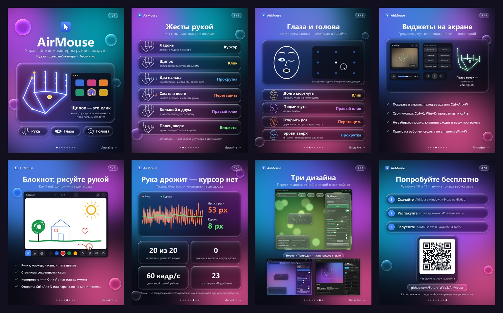

# AirMouse

Управление мышью в Windows 11 через веб-камеру: рукой, взглядом или поворотом головы.
Режим выбирается переключателем **Рука / Глаза / Голова** вверху окна.

**[Скачать AirMouse для Windows](https://github.com/Future-Web2/AirMouse/releases/latest/download/AirMouse-windows-x64.zip)** (zip, 83 МБ). Распакуйте архив целиком и запустите `AirMouse\AirMouse.exe`, Python не нужен. Все версии — на странице [Releases](https://github.com/Future-Web2/AirMouse/releases).

**Как пользоваться:** [гайд с картинками](docs/GUIDE.md) и [видео на полторы минуты](promo/AirMouse_guide.mp4).


## Запуск

Нужны Windows 10/11 и веб-камера.

- **Собрать программу:** запустите `build.bat` (нужен Python 3.12 или новее). Он сам создаст `.venv`, поставит зависимости, скачает модели руки и лица, если их нет, и соберёт `dist\AirMouse\AirMouse.exe`. Папку `dist\AirMouse` можно переносить только целиком. Собирайте в папке с коротким путём (например, `C:\src\AirMouse`): у MediaPipe длинные пути к файлам, и в глубоких папках Windows не загрузит его библиотеки.
- **Запустить из исходников:** `.venv\Scripts\python.exe main.py`
- **Проверить:** `.venv\Scripts\python.exe -m unittest` запускает автотесты, `main.py --bench` замеряет KPI (см. ниже).

Нажмите **Старт**: включится камера и управление. **Ctrl+Alt+M** ставит управление на паузу и снимает с неё, **Ctrl+Alt+W** прячет и показывает [виджеты на экране](#виджеты-на-экране), **Ctrl+Alt+N** открывает и закрывает [блокнот для рисования](#блокнот-рисовать-рукой).

## Три дизайна

Дизайн выбирается в настройках, в строке **Дизайн**: «Стекло» / «Природа» / «Классика». Окно сразу откроется в новом виде. Если камера была включена, она продолжит работать. Выбор запоминается.

| Liquid Glass | Природа | Классический |
|---|---|---|
|  |  |  |

**Природа** — то же жидкое стекло, только запотевшее: оно сильнее размывает и осветляет то, что за ним, а по стеклу разбросаны капли конденсата с бликами и редкие стёкшие дорожки. Под стеклом глубокий зелёный фон с медленными солнечными бликами. Виджеты на экране в этом дизайне тоже зелёные и в каплях.

**Классический** — обычные элементы Windows 11 (тема Sun Valley), превью камеры в отдельном окошке, светлая или тёмная тема подстраивается под систему.

### Liquid Glass

Камера заполняет всё окно, а панели управления плавают поверх неё, как стекло:

- они размывают изображение за собой и преломляют его у краёв, с лёгким радужным отливом;
- края подсвечены, будто на стекло падает свет сверху слева.

Переключатель режимов — это стеклянная капля, которая с упругой «жидкой» анимацией перетекает к выбранному пункту. Ручка ползунка, пока вы её тянете, превращается в прозрачную линзу. Пока камера выключена, за стеклом переливается цветной фон.

Окно отрисовывается программой целиком (`airmouse/glass.py`, `airmouse/widgets.py`) и выводится на экран напрямую через GDI (`airmouse/blit.py`). Когда AirMouse не на переднем плане, окно обновляется реже: управление мышью от этого не замедляется, а процессор не нагружается.

## Виджеты на экране

Пока AirMouse управляет мышью, поверх всех окон висят виджеты. Ими пользуются рукой, как любой программой: щипок нажимает кнопку, «сжать и вести» двигает ползунок или сам виджет, жест прокрутки над громкостью меняет её.


| Виджет | Что умеет |
|---|---|
| AirMouse | Камера с рукой, что видит программа, кадр/с. Карандаш открывает блокнот, шестерёнка — настройки виджетов |
| Громкость | Ползунок громкости Windows, прокрутка над ним, кнопка «без звука» |
| Музыка и видео | Предыдущий трек, пауза или воспроизведение, следующий трек |
| Панель кнопок | Ваши кнопки: сочетание клавиш или «открыть» программу, файл, сайт |
| Часы | Время и дата |
| Нагрузка компьютера | Процессор, память, батарея |
| [Блокнот](#блокнот-рисовать-рукой) | Страницы для рисования рукой, как в Paint |

- **Показать или скрыть:** подержите большой палец вверх полсекунды или нажмите **Ctrl+Alt+W**.
- **Виджеты не забирают фокус.** Кнопка «Копировать» нажимает Ctrl+C в той программе, где вы работаете, а «Клавиатура» открывает экранную клавиатуру Windows, чтобы печатать рукой.
- **Свои виджеты.** Кнопка **«Виджеты»** в окне AirMouse (в классическом дизайне — **«Виджеты…»**) открывает редактор. В нём включают нужные виджеты и создают сколько угодно панелей кнопок, до 12 кнопок в каждой. Кнопка может нажать клавиши (`ctrl+c`, `win+d`, `alt+tab`, `ctrl+shift+esc`, `f5`, `playpause`, `volumeup`) или открыть программу (`notepad`, `calc`, `osk`), сайт (`https://…`) или файл.
- **Виджеты и без камеры:** «Подробнее» → «Окно и виджеты» → «Виджеты на экране, даже когда камера выключена». Размер виджетов меняется там же.
- **Кольцо у курсора** показывает, что видит AirMouse: заполняется, пока пальцы сходятся (или закрыты глаза), вспыхивает при клике, показывает стрелки при прокрутке. Мышь проходит сквозь кольцо.
- Карточка **«Сеанс»** в окне AirMouse показывает кадр/с за последнюю минуту, нагрузку на процессор и сколько было кликов и прокруток.

Виджеты — это собственные прозрачные окна AirMouse (`airmouse/onscreen.py`, `airmouse/overlay.py`). Панель виджетов Windows 11 (Win+W) принимает только программы, установленные подписанным пакетом MSIX (например, из Microsoft Store), а AirMouse распространяется архивом, поэтому туда не встраивается. Виджеты AirMouse показываются прямо на экране: большой палец вверх или **Ctrl+Alt+W**.

## Блокнот: рисовать рукой

Черновик, как Paint, поверх всех окон: сожмите пальцы на бумаге и ведите руку — получается линия, разожмите — линия закончилась. Мышью рисуют так же, зажав левую кнопку.


- **Открыть или закрыть:** кнопка **«Блокнот»** в окне AirMouse, карандаш на мини-панели AirMouse (это можно сделать рукой), **Ctrl+Alt+N** или крестик на самом блокноте. Блокнот виден и при выключенной камере, тогда в нём рисуют мышью.
- **Инструменты:** ручка, толстый маркер, ластик и пять цветов. Выбор цвета убирает ластик.
- **Отменить** снимает последние линии по одной, отменяется и очистка страницы.
- **Страницы:** «‹ ›» листают, «+» добавляет новую. Каждая страница сама сохраняется картинкой PNG через секунду после изменения в `%APPDATA%\AirMouse\notebook` и открывается в следующий раз. Кнопка с папкой открывает эту папку.
- **Копировать** кладёт страницу картинкой в буфер обмена: её можно вставить через Ctrl+V в чат, документ или письмо.
- Кнопка в углу разворачивает блокнот почти на весь экран, чтобы рисовать крупнее, и сворачивает обратно.

Рука в воздухе дрожит сильнее, чем мышь на столе, поэтому линии получаются чуть неровными. Помогают «Стабилизация» правее и «Подробнее» → «Клики» → «Сдвиг для начала перетаскивания» поменьше (например, 10 px): тогда линия начинается сразу после щипка.

## «Подробнее»: точная настройка

Кнопка **«Подробнее»** открывает 23 параметра в шести вкладках: камера, курсор, клики, жесты, лицо, окно и виджеты. Каждый можно увеличить или уменьшить. Всё применяется сразу, настройки камеры перезапускают её сами, а «По умолчанию» возвращает всё как было. Хранятся только изменённые значения.


- **60 кадр/с** («Камера» → «Частота кадров камеры»): курсор точнее и отзывчивее, если камера это умеет. Для 60 кадр/с и 1280×720 AirMouse просит у камеры сжатый поток MJPG, иначе многие веб-камеры не дают такую скорость. Сколько кадров камера даёт на самом деле, видно в карточке «Сеанс».
- Все задержки жестов заданы в миллисекундах, а не в кадрах, поэтому при 60 кадр/с жесты срабатывают так же, как при 30.
- Остальное: мёртвая зона и отзывчивость курсора, фильтр сбоев камеры, время подтверждения щипка и правого клика, шаг прокрутки, удержание «пальца вверх», пороги для глаз, рта и бровей, частота окна, размер виджетов.

Что делает каждый параметр и готовые рецепты («максимальная точность», «меньше случайных кликов» и другие) — в [гайде](docs/GUIDE.md#7-подробнее-точная-настройка).

## Видео-гайд, промо-ролик и постер

- [`promo/AirMouse_guide.mp4`](promo/AirMouse_guide.mp4) — видео-гайд 1920×1080 на 1 минуту 25 секунд, с музыкой: установка, «Старт», как держать руку, жесты, виджеты, глаза и голова, «Подробнее», дизайн «Природа», советы. Всё сказано подписями, поэтому оно смотрится и без звука.
- [`promo/POST.md`](promo/POST.md) — готовые тексты поста для Telegram, VK, YouTube и X.
- [`promo/AirMouse_promo.mp4`](promo/AirMouse_promo.mp4) — промо-ролик 1920×1080 длиной около 53 секунд, с музыкой.
- [`promo/AirMouse_poster.png`](promo/AirMouse_poster.png) — постер 1440×1800 (4:5) для публикации в Telegram. Пересобрать: `.venv\Scripts\python.exe promo\make_poster.py`.
- [`promo/carousel/`](promo/carousel/) — карусель из 8 картинок 1440×1800 в том же стиле:
  - обложка;
  - жесты;
  - глаза и голова;
  - виджеты;
  - блокнот;
  - точность в цифрах;
  - три дизайна;
  - как скачать, с QR-кодом.

  Там же все страницы одним PDF. Пересобрать: `.venv\Scripts\python.exe promo\make_carousel.py`, для QR-кода нужен `pip install segno`.




Ролики целиком сгенерированы скриптами:

- курсор в сценах с рукой двигает настоящий движок жестов, а в гайде им же двигается ползунок громкости на настоящих виджетах;
- график стабилизации построен на настоящих фильтрах;
- окна программы в роликах настоящие, они рисуются прямо в видео и не появляются на экране. Окно «Подробнее» показано по снимкам настоящего (`promo/guide/`, их делает `tools\capture_advanced.py`).

Пересобрать ролики:

```
.venv\Scripts\python.exe -m pip install imageio-ffmpeg
.venv\Scripts\python.exe promo\make_promo.py
.venv\Scripts\python.exe promo\make_guide.py
```

Отдельные кадры для проверки: `promo\make_guide.py --stills 8,30,60`.

## Жесты рукой (режим «Рука»)

| Жест | Действие |
|---|---|
| Двигать ладонью | Курсор |
| Коснуться большим пальцем указательного | Левый клик (два раза подряд — двойной клик) |
| Сжать, подержать и вести руку | Перетаскивание |
| Коснуться большим пальцем указательного и среднего | Правый клик |
| Поднять указательный и средний, остальные согнуть, вести вверх/вниз | Прокрутка |
| Сжать кулак, большой палец вверх, подержать полсекунды | Показать или скрыть виджеты |

## Глаза и голова (режимы «Глаза» и «Голова»)

Курсор двигается так:

- **Глаза:** курсор переносится туда, куда вы смотрите, а лёгкий поворот головы точно его доводит. Веб-камера видит взгляд лишь примерно (обычно с точностью 100–200 px), поэтому доводка головой нужна, чтобы попадать в мелкие кнопки.
- **Голова:** курсор следует за поворотом головы. Это самый точный способ без рук. Кнопка «Центр по положению головы» задаёт, при каком положении головы курсор стоит в центре экрана.

Клики в обоих режимах одинаковые:

| Жест | Действие |
|---|---|
| Закрыть глаза примерно на полсекунды | Левый клик (два раза подряд — двойной клик) |
| Подмигнуть одним глазом | Правый клик |
| Открыть рот | Зажать левую кнопку (перетаскивание), закрыть рот — отпустить |
| Поднять брови и наклонить голову вверх/вниз | Прокрутка |

Обычное моргание кликом не считается. Пока глаза закрыты, курсор стоит на месте.

**Калибровка взгляда.** При первом запуске режима «Глаза» калибровка откроется сама и займёт около 25 секунд:

1. Смотрите на точку в центре и медленно поворачивайте голову. Так программа узнаёт, как ваши глаза компенсируют поворот.
2. Смотрите по очереди на 9 точек, держа голову ровно.

После калибровки внизу настроек будет показана её точность. Если сели иначе или изменился свет, просто повторите её. Индикаторы «Лицо» под превью показывают, насколько камера видит закрытые глаза, открытый рот и поднятые брови.

## Советы

- Камера должна видеть всю ладонь, рука примерно в 40–70 см от неё.
- Хороший свет делает трекинг стабильнее: при плохом освещении камера даёт только 15 кадров/с. Для режима «Глаза» особенно важно, чтобы свет падал на лицо спереди, а не из окна за спиной.
- **Центр зоны по руке:** нажмите кнопку и за 3 секунды поднимите руку в удобное положение. Рамка на превью — это зона, которая растягивается на весь экран.
- Курсор дрожит → увеличьте «Стабилизацию». Клик срабатывает сам → уменьшите «Чувствительность клика».
- Нужна максимальная точность → «Подробнее» → «Камера» → 60 кадр/с.

## Как работает стабилизация

1. Курсор следует за центром ладони, а не за кончиком пальца, поэтому щипок не сдвигает курсор.
2. Медиана по 3 кадрам отбрасывает одиночные сбои трекинга.
3. Фильтр One Euro сильно сглаживает медленные движения и почти не тормозит быстрые.
4. «Поводок»: курсор тянется за рукой на короткой нитке, и дрожание меньше её длины до экрана не доходит.
5. Пока пальцы сомкнуты, курсор стоит на месте, а клик попадает туда, где курсор был до начала щипка.

## Качество и KPI

У программы есть измеримые цели ([docs/KPI.md](docs/KPI.md)): размер архива, время до появления окна, нагрузка на процессор от интерфейса, точность курсора и кликов. В версии 1.1.0:

- архив 83 МБ вместо 124 МБ;
- повторный запуск открывает окно за 0,3 с вместо 0,9 с;
- окно Liquid Glass нагружает процессор в 2,3–2,6 раза меньше при той же картинке;
- курсор не дрожит у неподвижной руки, 20 щипков из 20 дают ровно один клик, ложных кликов нет.

В версии 1.2.0 появились виджеты на экране. Мини-панель с камерой перерисовывается примерно за 1 мс, кольцо у курсора — за 0,3 мс. Жест «палец вверх» срабатывает за 0,6 с и ни разу не сработал случайно от щипков, прокрутки или дрожащей руки.

В версии 1.3.0 появились 60 кадр/с камеры и ещё 22 параметра в «Подробнее». При 60 кадр/с KPI те же, что при 30: 20 щипков из 20 дают ровно 20 кликов, неподвижная рука не двигает курсор, ложных действий нет.

В версии 1.4.0 появился блокнот. Во время рисования он перерисовывается за 4 мс при масштабе 150%. В автотесте линию рисует настоящий движок жестов: щипок, провести руку, разжать. Получается одна линия на всём пути и ни одного лишнего клика.

Замерить на своём компьютере: `AirMouse.exe --bench report.json`. KPI и остальную логику проверяют 153 автотеста, они запускаются в GitHub Actions на каждый push.

## Ограничения

- Windows не даёт обычным программам управлять окнами, запущенными от имени администратора (например, Диспетчером задач). Чтобы управлять и ими, запустите AirMouse от имени администратора.
- Управление работает на основном мониторе.
- Настройки хранятся в `%APPDATA%\AirMouse\settings.json`.
