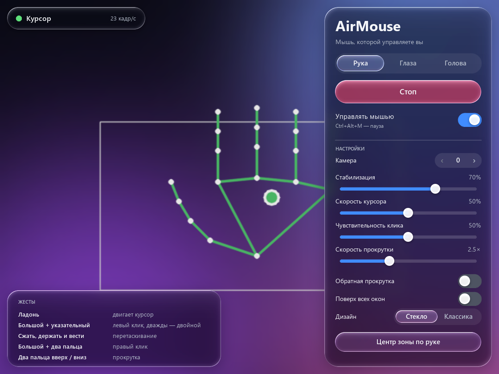
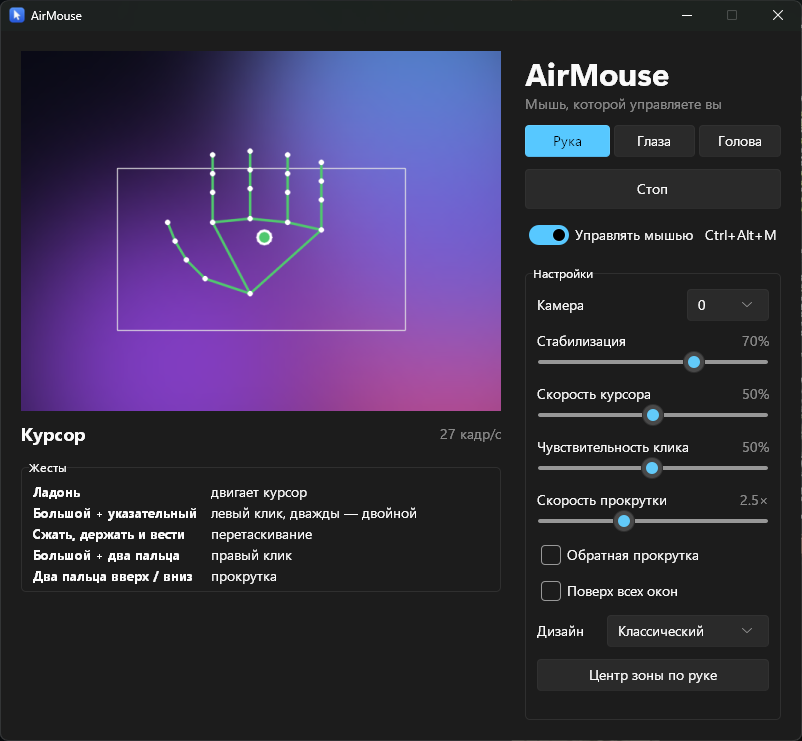
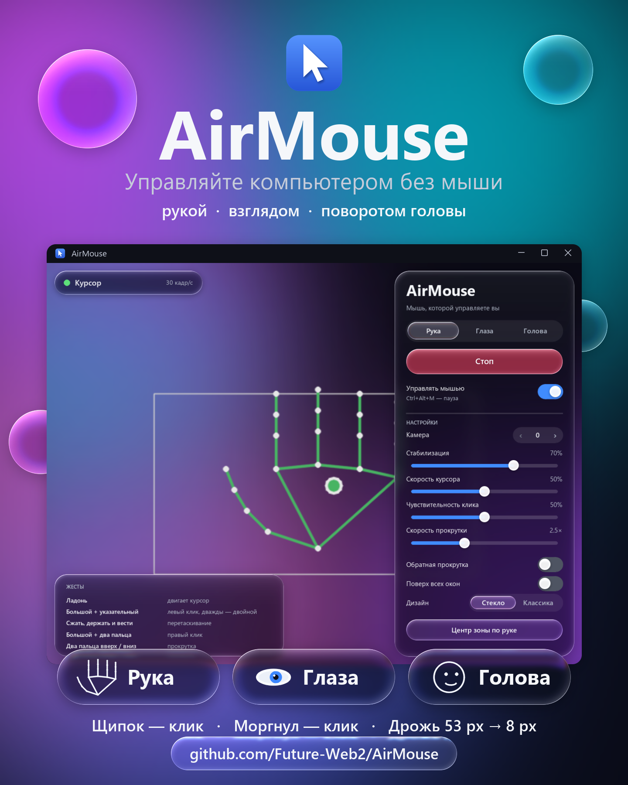

# AirMouse

Управление мышью в Windows 11 через веб-камеру: рукой, взглядом или поворотом головы.
Режим выбирается переключателем **Рука / Глаза / Голова** вверху окна.

**[Скачать AirMouse для Windows](https://github.com/Future-Web2/AirMouse/releases/latest/download/AirMouse-windows-x64.zip)** (zip, 124 МБ). Распакуйте архив целиком и запустите `AirMouse\AirMouse.exe`, Python не нужен. Все версии — на странице [Releases](https://github.com/Future-Web2/AirMouse/releases).



## Запуск

Нужны Windows 10/11 и веб-камера.

- **Собрать программу:** запустите `build.bat` (нужен Python 3.12 или новее). Он сам создаст `.venv`, поставит зависимости, скачает модели руки и лица, если их нет, и соберёт `dist\AirMouse\AirMouse.exe`. Папку `dist\AirMouse` можно переносить только целиком.
- **Запустить из исходников:** `.venv\Scripts\python.exe main.py`

Нажмите **Старт**: включится камера и управление. **Ctrl+Alt+M** ставит управление на паузу и снимает с неё.

## Два дизайна

Дизайн выбирается в настройках, в строке **Дизайн**: «Стекло» / «Классика». Окно сразу откроется в новом виде. Если камера была включена, она продолжит работать. Выбор запоминается.

| Liquid Glass | Классический |
|---|---|
|  |  |

**Классический** — обычные элементы Windows 11 (тема Sun Valley), превью камеры в отдельном окошке, светлая или тёмная тема подстраивается под систему.

### Liquid Glass

Камера заполняет всё окно, а панели управления плавают поверх неё, как стекло:

- они размывают изображение за собой и преломляют его у краёв, с лёгким радужным отливом;
- края подсвечены, будто на стекло падает свет сверху слева.

Переключатель режимов — это стеклянная капля, которая с упругой «жидкой» анимацией перетекает к выбранному пункту. Ручка ползунка, пока вы её тянете, превращается в прозрачную линзу. Пока камера выключена, за стеклом переливается цветной фон.

Окно отрисовывается программой целиком (`airmouse/glass.py`, `airmouse/widgets.py`). Когда AirMouse не на переднем плане, окно обновляется реже: управление мышью от этого не замедляется, а процессор не нагружается.

## Промо-ролик и постер

- [`promo/AirMouse_promo.mp4`](promo/AirMouse_promo.mp4) — ролик 1920×1080 длиной около 53 секунд, с музыкой.
- [`promo/AirMouse_poster.png`](promo/AirMouse_poster.png) — постер 1440×1800 (4:5) для публикации в Telegram. Пересобрать: `.venv\Scripts\python.exe promo\make_poster.py`.



Ролик целиком сгенерирован скриптом:

- курсор в сцене с рукой двигает настоящий движок жестов;
- график стабилизации построен на настоящих фильтрах;
- в сцене с интерфейсом показано настоящее окно программы.

Пересобрать ролик:

```
.venv\Scripts\python.exe -m pip install imageio-ffmpeg
.venv\Scripts\python.exe promo\make_promo.py
```

Отдельные кадры для проверки: `promo\make_promo.py --stills 3,15,33`.

## Жесты рукой (режим «Рука»)

| Жест | Действие |
|---|---|
| Двигать ладонью | Курсор |
| Коснуться большим пальцем указательного | Левый клик (два раза подряд — двойной клик) |
| Сжать, подержать и вести руку | Перетаскивание |
| Коснуться большим пальцем указательного и среднего | Правый клик |
| Поднять указательный и средний, остальные согнуть, вести вверх/вниз | Прокрутка |

## Глаза и голова (режимы «Глаза» и «Голова»)

Курсор двигается так:

- **Глаза:** курсор переносится туда, куда вы смотрите, а лёгкий поворот головы точно его доводит. Веб-камера видит взгляд лишь примерно (обычно с точностью 100–200 px), поэтому доводка головой нужна, чтобы попадать в мелкие кнопки.
- **Голова:** курсор следует за поворотом головы. Это самый точный способ без рук. Кнопка «Центр по положению головы» задаёт, при каком положении головы курсор стоит в центре экрана.

Клики в обоих режимах одинаковые:

| Жест | Действие |
|---|---|
| Закрыть глаза примерно на полсекунды | Левый клик (два раза подряд — двойной клик) |
| Подмигнуть одним глазом | Правый клик |
| Открыть рот | Зажать левую кнопку (перетаскивание), закрыть рот — отпустить |
| Поднять брови и наклонить голову вверх/вниз | Прокрутка |

Обычное моргание кликом не считается. Пока глаза закрыты, курсор стоит на месте.

**Калибровка взгляда.** При первом запуске режима «Глаза» калибровка откроется сама и займёт около 25 секунд:

1. Смотрите на точку в центре и медленно поворачивайте голову. Так программа узнаёт, как ваши глаза компенсируют поворот.
2. Смотрите по очереди на 9 точек, держа голову ровно.

После калибровки внизу настроек будет показана её точность. Если сели иначе или изменился свет, просто повторите её. Индикаторы «Лицо» под превью показывают, насколько камера видит закрытые глаза, открытый рот и поднятые брови.

## Советы

- Камера должна видеть всю ладонь, рука примерно в 40–70 см от неё.
- Хороший свет делает трекинг стабильнее: при плохом освещении камера даёт только 15 кадров/с. Для режима «Глаза» особенно важно, чтобы свет падал на лицо спереди, а не из окна за спиной.
- **Центр зоны по руке:** нажмите кнопку и за 3 секунды поднимите руку в удобное положение. Рамка на превью — это зона, которая растягивается на весь экран.
- Курсор дрожит → увеличьте «Стабилизацию». Клик срабатывает сам → уменьшите «Чувствительность клика».

## Как работает стабилизация

1. Курсор следует за центром ладони, а не за кончиком пальца, поэтому щипок не сдвигает курсор.
2. Медиана по 3 кадрам отбрасывает одиночные сбои трекинга.
3. Фильтр One Euro сильно сглаживает медленные движения и почти не тормозит быстрые.
4. «Поводок»: курсор тянется за рукой на короткой нитке, и дрожание меньше её длины до экрана не доходит.
5. Пока пальцы сомкнуты, курсор стоит на месте, а клик попадает туда, где курсор был до начала щипка.

## Ограничения

- Windows не даёт обычным программам управлять окнами, запущенными от имени администратора (например, Диспетчером задач). Чтобы управлять и ими, запустите AirMouse от имени администратора.
- Управление работает на основном мониторе.
- Настройки хранятся в `%APPDATA%\AirMouse\settings.json`.
