# AirMouse

**Русский** · [English](README.en.md)

Управление мышью в Windows и Linux через веб-камеру, не касаясь компьютера: рукой, двумя руками, взглядом или поворотом головы.
Режим выбирается переключателем **Рука / Глаза / Голова** вверху окна. Интерфейс на русском и английском: переключатель **RU | EN**.

**[Скачать AirMouse для Windows](https://github.com/Future-Web2/AirMouse/releases/latest/download/AirMouse-windows-x64.zip)** (zip, 83 МБ). Распакуйте архив целиком и запустите `AirMouse\AirMouse.exe`, Python не нужен. Все версии — на странице [Releases](https://github.com/Future-Web2/AirMouse/releases).

**[Скачать для Linux](https://github.com/Future-Web2/AirMouse/releases/latest/download/AirMouse-linux-x64.tar.gz)** (tar.gz): как установить — в разделе [Linux](#linux).

**Как пользоваться:** [гайд с картинками](docs/GUIDE.md) ([English guide](docs/GUIDE.en.md)) и [видео на полторы минуты](promo/AirMouse_guide.mp4).

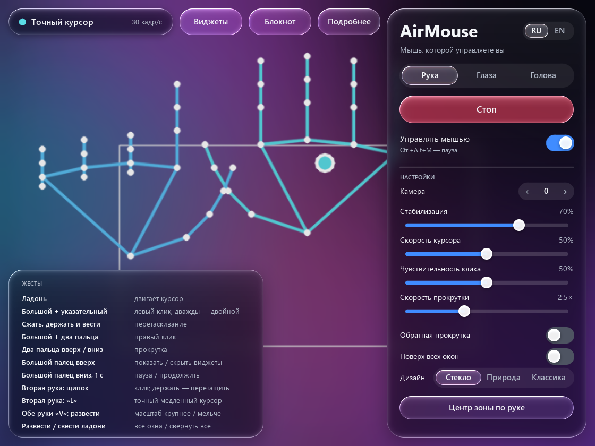

## Запуск

Нужны Windows 10/11 или Linux (см. [Linux](#linux)) и веб-камера.

- **Собрать программу:** запустите `build.bat` (нужен Python 3.12 или новее). Он сам создаст `.venv`, поставит зависимости, скачает модели руки и лица, если их нет, и соберёт `dist\AirMouse\AirMouse.exe`. Папку `dist\AirMouse` можно переносить только целиком. Собирайте в папке с коротким путём (например, `C:\src\AirMouse`): у MediaPipe длинные пути к файлам, и в глубоких папках Windows не загрузит его библиотеки.
- **Запустить из исходников:** `.venv\Scripts\python.exe main.py`
- **Проверить:** `.venv\Scripts\python.exe -m unittest` запускает автотесты, `main.py --bench` замеряет KPI (см. ниже).

Нажмите **Старт**: включится камера и управление. **Ctrl+Alt+M** (или большой палец вниз на секунду) ставит управление на паузу и снимает с неё, **Ctrl+Alt+W** прячет и показывает [виджеты на экране](#виджеты-на-экране), **Ctrl+Alt+N** открывает и закрывает [блокнот для рисования](#блокнот-рисовать-рукой).

## Linux

AirMouse работает и в Linux: под X11 и под Wayland (GNOME, KDE Plasma и другие).

**[Скачать AirMouse для Linux](https://github.com/Future-Web2/AirMouse/releases/latest/download/AirMouse-linux-x64.tar.gz)** (tar.gz, x86-64; Ubuntu 22.04, Debian 12, Fedora 36 и новее). Архив собирает GitHub Actions на Ubuntu 22.04 и прикладывает к релизу.

```bash
tar -xzf AirMouse-linux-x64.tar.gz
cd AirMouse
./install.sh
./AirMouse
```

`install.sh` делает две вещи:

1. добавляет AirMouse в меню приложений;
2. даёт доступ к `/dev/uinput`, для этого спросит пароль: ставит правило udev `99-airmouse-uinput.rules` и добавляет вас в группу `input`.

Через `/dev/uinput` AirMouse двигает мышь и нажимает клавиши, одинаково под X11 и Wayland. Без него под X11 мышь всё равно работает через расширение XTEST, а под Wayland AirMouse покажет, как дать доступ. Если сразу после `install.sh` мышь не двигается, выйдите из системы и войдите снова. Только меню, без пароля: `./install.sh --menu`.

Устройство `/dev/uinput` может нажимать любые клавиши. Правило даёт доступ только тому, кто сидит за компьютером, и группе `input`, а не всем программам.

**Из исходников:** нужен Python 3.12 или новее с Tk (Debian, Ubuntu: `sudo apt install python3-venv python3-tk`). `./build.sh` соберёт `dist/AirMouse/AirMouse` и архив `dist/AirMouse-linux-x64.tar.gz`. Запуск без сборки: `.venv/bin/python main.py`.

**Чем Linux отличается от Windows:**

| | X11 | Wayland |
|---|---|---|
| Курсор, клики, прокрутка, масштаб | да | да, через `/dev/uinput` |
| Ctrl+Alt+M, Ctrl+Alt+W, Ctrl+Alt+N | в любом окне | пока активно окно AirMouse; пауза жестом работает всегда |
| Развернуть и свернуть окно второй рукой | через диспетчер окон | клавишами рабочего стола: Super+Up и Super+H (GNOME), Meta+PgUp и Meta+PgDown (KDE) |
| Свернуть все окна (свести ладони) | через диспетчер окон | Super+D |
| Все окна (развести ладони) | Super в GNOME, Meta+W в KDE | так же |

- **Виджеты на экране** — отдельные окна без рамки поверх всех окон, со скруглёнными углами, но без мягкой тени: без композитора X11 не умеет полупрозрачные края. Кольцо у курсора пропускает клики сквозь себя через расширение SHAPE. Под Wayland виджеты работают через XWayland.
- **Значки** на виджетах — обычные символы шрифта (▶ ⚙ ✎). Значков Segoe Fluent в Linux нет, и шрифт подбирает fontconfig.
- **Громкость:** через PipeWire (`wpctl`) или PulseAudio (`pactl`).
- **Копирование страницы блокнота:** через `wl-copy` (Wayland) или `xclip` (X11).
- **Экранная клавиатура:** кнопка «Клавиатура» открывает Onboard, если он установлен. Кнопки «Рабочий стол», «Все окна», «Скриншот» нажимают клавиши, которые понимает ваш рабочий стол.
- **Экранная лупа двумя руками** в GNOME сначала включается один раз сочетанием Alt+Super+8.
- **Камера** открывается через V4L2. Настройки хранятся в `~/.config/AirMouse/`.

Linux-версию проверяют 25 автотестов с подставным ядром, X11 и программами, а весь набор тестов и проверка моделей запускаются на Ubuntu в GitHub Actions. На настоящем рабочем столе Linux с камерой эту версию пока никто не проверял. Если что-то не работает, напишите в [Issues](https://github.com/Future-Web2/AirMouse/issues): версию дистрибутива, X11 или Wayland, рабочий стол.

## Язык: русский и английский

Весь интерфейс есть на двух языках: главное окно, виджеты на экране, «Подробнее», редактор виджетов, калибровка и сообщения об ошибках. Переключатель **RU | EN** стоит рядом с названием AirMouse, в классическом дизайне — строка **«Язык · Language»**. Окно сразу откроется на выбранном языке, камера продолжит работать.

При первом запуске AirMouse берёт язык Windows: русский, если Windows на русском (или на белорусском, казахском, киргизском, таджикском, узбекском), иначе английский. У тех, кто пользовался AirMouse раньше, остаётся русский.

| Русский | English |
|---|---|
|  | 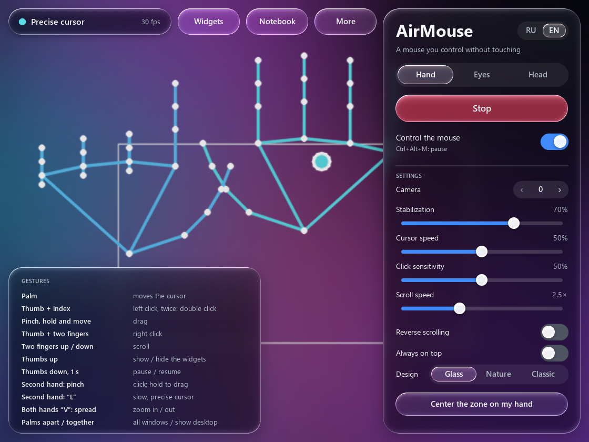 |

Все строки интерфейса собраны в словарь `airmouse/i18n.py`, а автотест `tests/test_i18n.py` проверяет, что у каждой русской строки есть английский перевод с теми же числами на месте.

## Три дизайна

Дизайн выбирается в настройках, в строке **Дизайн**: «Стекло» / «Природа» / «Классика». Окно сразу откроется в новом виде. Если камера была включена, она продолжит работать. Выбор запоминается.

| Liquid Glass | Природа | Классический |
|---|---|---|
|  | 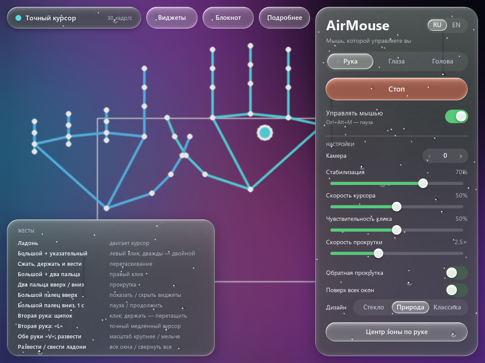 | 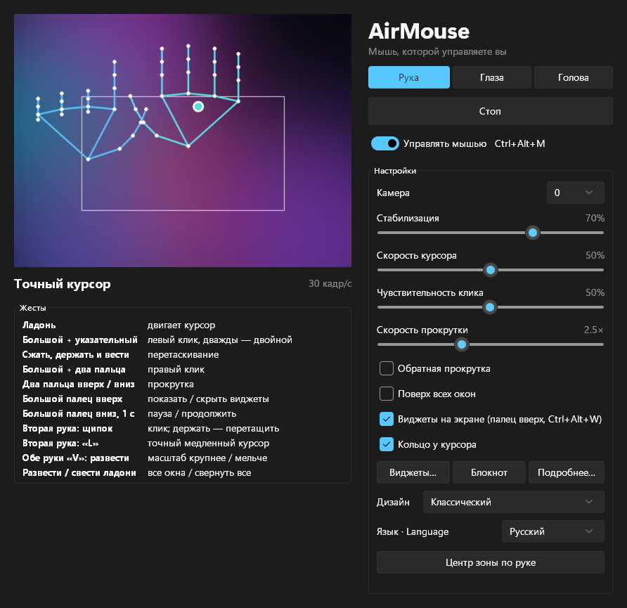 |

**Природа** — то же жидкое стекло, только запотевшее: оно сильнее размывает и осветляет то, что за ним, а по стеклу разбросаны капли конденсата с бликами и редкие стёкшие дорожки. Под стеклом глубокий зелёный фон с медленными солнечными бликами. Виджеты на экране в этом дизайне тоже зелёные и в каплях.

**Классический** — обычные элементы Windows 11 (тема Sun Valley), превью камеры в отдельном окошке, светлая или тёмная тема подстраивается под систему.

### Liquid Glass

Камера заполняет всё окно, а панели управления плавают поверх неё, как стекло:

- они размывают изображение за собой и преломляют его у краёв, с лёгким радужным отливом;
- края подсвечены, будто на стекло падает свет сверху слева.

Переключатель режимов — это стеклянная капля, которая с упругой «жидкой» анимацией перетекает к выбранному пункту. Ручка ползунка, пока вы её тянете, превращается в прозрачную линзу. Пока камера выключена, за стеклом переливается цветной фон.

Окно отрисовывается программой целиком (`airmouse/glass.py`, `airmouse/widgets.py`) и выводится на экран напрямую через GDI (`airmouse/blit.py`). Когда AirMouse не на переднем плане, окно обновляется реже: управление мышью от этого не замедляется, а процессор не нагружается.

## Виджеты на экране

Пока AirMouse управляет мышью, поверх всех окон висят виджеты. Ими пользуются рукой, как любой программой: щипок нажимает кнопку, «сжать и вести» двигает ползунок или сам виджет, жест прокрутки над громкостью меняет её.

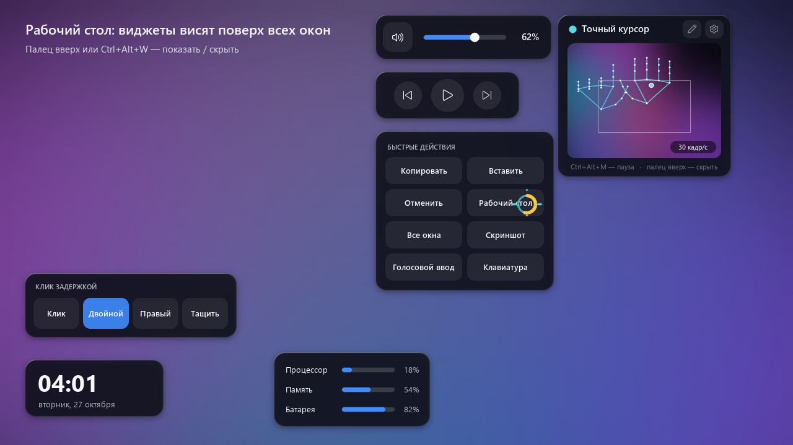

| Виджет | Что умеет |
|---|---|
| AirMouse | Камера с рукой, что видит программа, кадр/с. Карандаш открывает блокнот, шестерёнка — настройки виджетов |
| Громкость | Ползунок громкости Windows, прокрутка над ним, кнопка «без звука» |
| Музыка и видео | Предыдущий трек, пауза или воспроизведение, следующий трек |
| Панель кнопок | Ваши кнопки: сочетание клавиш или «открыть» программу, файл, сайт |
| Часы | Время и дата |
| Нагрузка компьютера | Процессор, память, батарея |
| [Блокнот](#блокнот-рисовать-рукой) | Страницы для рисования рукой, как в Paint |
| [Клик задержкой](#две-руки-и-доступность) | Какой будет следующий клик задержкой: обычный, двойной, правый или перетаскивание. Видна, пока клик задержкой включён |

- **Показать или скрыть:** подержите большой палец вверх полсекунды или нажмите **Ctrl+Alt+W**.
- **Виджеты не забирают фокус.** Кнопка «Копировать» нажимает Ctrl+C в той программе, где вы работаете, а «Клавиатура» открывает экранную клавиатуру Windows, чтобы печатать рукой.
- **Свои виджеты.** Кнопка **«Виджеты»** в окне AirMouse (в классическом дизайне — **«Виджеты…»**) открывает редактор. В нём включают нужные виджеты и создают сколько угодно панелей кнопок, до 12 кнопок в каждой. Кнопка может нажать клавиши (`ctrl+c`, `win+d`, `alt+tab`, `ctrl+shift+esc`, `f5`, `playpause`, `volumeup`) или открыть программу (`notepad`, `calc`, `osk`), сайт (`https://…`) или файл.
- **Виджеты и без камеры:** «Подробнее» → «Окно и виджеты» → «Виджеты на экране, даже когда камера выключена». Размер виджетов меняется там же.
- **Кольцо у курсора** показывает, что видит AirMouse: заполняется, пока пальцы сходятся (или закрыты глаза), вспыхивает при клике, показывает стрелки при прокрутке. Мышь проходит сквозь кольцо.
- Карточка **«Сеанс»** в окне AirMouse показывает кадр/с за последнюю минуту, нагрузку на процессор и сколько было кликов и прокруток.

Виджеты — это собственные прозрачные окна AirMouse (`airmouse/onscreen.py`, `airmouse/overlay.py`). Панель виджетов Windows 11 (Win+W) принимает только программы, установленные подписанным пакетом MSIX (например, из Microsoft Store), а AirMouse распространяется архивом, поэтому туда не встраивается. Виджеты AirMouse показываются прямо на экране: большой палец вверх или **Ctrl+Alt+W**.

## Блокнот: рисовать рукой

Черновик, как Paint, поверх всех окон: сожмите пальцы на бумаге и ведите руку — получается линия, разожмите — линия закончилась. Мышью рисуют так же, зажав левую кнопку.

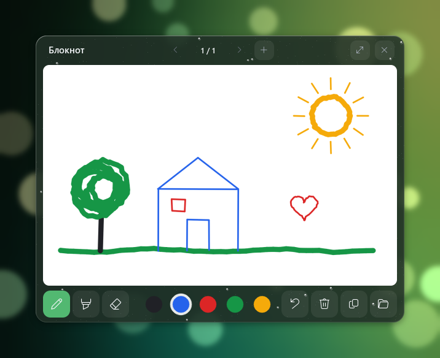

- **Открыть или закрыть:** кнопка **«Блокнот»** в окне AirMouse, карандаш на мини-панели AirMouse (это можно сделать рукой), **Ctrl+Alt+N** или крестик на самом блокноте. Блокнот виден и при выключенной камере, тогда в нём рисуют мышью.
- **Инструменты:** ручка, толстый маркер, ластик и пять цветов. Выбор цвета убирает ластик.
- **Отменить** снимает последние линии по одной, отменяется и очистка страницы.
- **Страницы:** «‹ ›» листают, «+» добавляет новую. Каждая страница сама сохраняется картинкой PNG через секунду после изменения в `%APPDATA%\AirMouse\notebook` и открывается в следующий раз. Кнопка с папкой открывает эту папку.
- **Копировать** кладёт страницу картинкой в буфер обмена: её можно вставить через Ctrl+V в чат, документ или письмо.
- Кнопка в углу разворачивает блокнот почти на весь экран, чтобы рисовать крупнее, и сворачивает обратно.

Рука в воздухе дрожит сильнее, чем мышь на столе, поэтому линии получаются чуть неровными. Помогают «Стабилизация» правее и «Подробнее» → «Клики» → «Сдвиг для начала перетаскивания» поменьше (например, 10 px): тогда линия начинается сразу после щипка.

## «Подробнее»: точная настройка

Кнопка **«Подробнее»** открывает 33 параметра в восьми вкладках: камера, курсор, клики, жесты, лицо, окно и виджеты, две руки, доступность. Каждый можно увеличить или уменьшить. Всё применяется сразу, настройки камеры перезапускают её сами, а «По умолчанию» возвращает всё как было. Хранятся только изменённые значения.

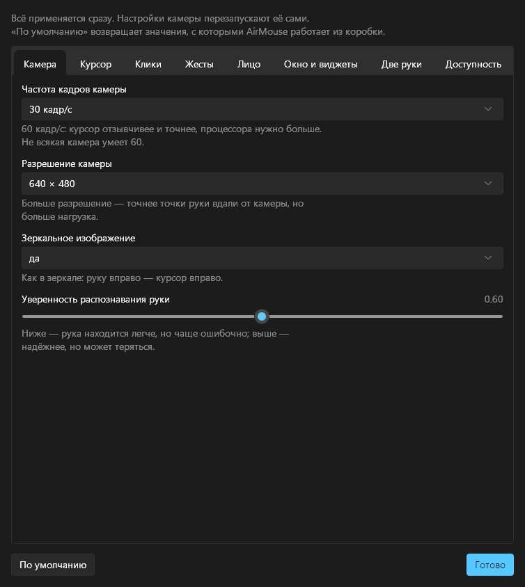

- **60 кадр/с** («Камера» → «Частота кадров камеры»): курсор точнее и отзывчивее, если камера это умеет. Для 60 кадр/с и 1280×720 AirMouse просит у камеры сжатый поток MJPG, иначе многие веб-камеры не дают такую скорость. Сколько кадров камера даёт на самом деле, видно в карточке «Сеанс».
- Все задержки жестов заданы в миллисекундах, а не в кадрах, поэтому при 60 кадр/с жесты срабатывают так же, как при 30.
- Остальное: мёртвая зона и отзывчивость курсора, фильтр сбоев камеры, время подтверждения щипка и правого клика, шаг прокрутки, удержание «пальца вверх», пороги для глаз, рта и бровей, частота окна, размер виджетов.

Что делает каждый параметр и готовые рецепты («максимальная точность», «меньше случайных кликов» и другие) — в [гайде](docs/GUIDE.md#7-подробнее-точная-настройка).

## Сайт

Папка [`site/`](site/) — сайт программы для адреса `airmouse.veranix.xyz`: одна страница на русском и английском с рекламным роликом, жестами, цифрами и кнопками скачивания. Это готовые статические файлы: их можно положить на любой хостинг или опубликовать через GitHub Pages (`.github/workflows/site.yml`).

Страницы собирает `.venv\Scripts\python.exe tools\build_site.py`; с ключом `--assets` он заново делает картинки и видео из `promo/` и `docs/`. Тексты лежат в `tools/site_texts.py`, адрес сайта, версия и ссылки для поддержки — в начале `tools/build_site.py`.

## Видео-гайд, промо-ролик и постер

- [`promo/AirMouse_ad.mp4`](promo/AirMouse_ad.mp4) — **главный рекламный ролик**: 60 секунд, 1920×1080, с музыкой. Есть английская версия: [`promo/AirMouse_ad_en.mp4`](promo/AirMouse_ad_en.mp4). Он и продаёт, и объясняет:
  - вопрос и ответ в первые секунды: щипок в воздухе нажимает кнопку;
  - три ситуации, когда мышь мешает;
  - три шага, чтобы начать: скачать, нажать «Старт», показать ладонь;
  - четыре жеста на настоящем движке;
  - виджеты, блокнот, глаза и голова, две руки;
  - измеренные цифры точности;
  - призыв: бесплатно, Windows и Linux, QR-код и адрес.

  Сцены сменяются в такт музыке (120 ударов в минуту, каждая сцена начинается с такта), всё сказано подписями. Пересобрать: `.venv\Scripts\python.exe promo\make_ad.py`, английская версия — с `--lang en`. Адрес и QR-код в конце ролика ведут на сайт программы; они берутся из `CTA_URL` в начале скрипта.
- [`promo/AirMouse_guide.mp4`](promo/AirMouse_guide.mp4) — видео-гайд 1920×1080 на 1 минуту 25 секунд, с музыкой: установка, «Старт», как держать руку, жесты, виджеты, глаза и голова, «Подробнее», дизайн «Природа», советы. Всё сказано подписями, поэтому оно смотрится и без звука.
- [`promo/POST.md`](promo/POST.md) — готовые тексты поста для Telegram, VK, YouTube и X.
- [`promo/AirMouse_promo.mp4`](promo/AirMouse_promo.mp4) — первый промо-ролик (версия 1.0), 1920×1080, около 53 секунд, с музыкой. Его заменил рекламный ролик выше.
- [`promo/AirMouse_poster.png`](promo/AirMouse_poster.png) — постер 1440×1800 (4:5) для публикации в Telegram. Пересобрать: `.venv\Scripts\python.exe promo\make_poster.py`.
- [`promo/carousel/`](promo/carousel/) — карусель из 8 картинок 1440×1800 в том же стиле (тёмно-синий и бирюзовый, без красного и фиолетового):
  - обложка;
  - жесты;
  - глаза и голова;
  - виджеты;
  - блокнот;
  - точность в цифрах;
  - тонкая настройка;
  - как скачать, с QR-кодом.

  Там же все страницы одним PDF. Пересобрать: `.venv\Scripts\python.exe promo\make_carousel.py`, для QR-кода нужен `pip install segno`.
- [`promo/AirMouse_vertical.mp4`](promo/AirMouse_vertical.mp4) — вертикальное видео для Reels, Shorts и TikTok: 36 секунд, 1080×1920, в том же стиле. Музыка — свой бит, его можно публиковать без проблем с правами. Пересобрать: `.venv\Scripts\python.exe promo\make_vertical.py`.

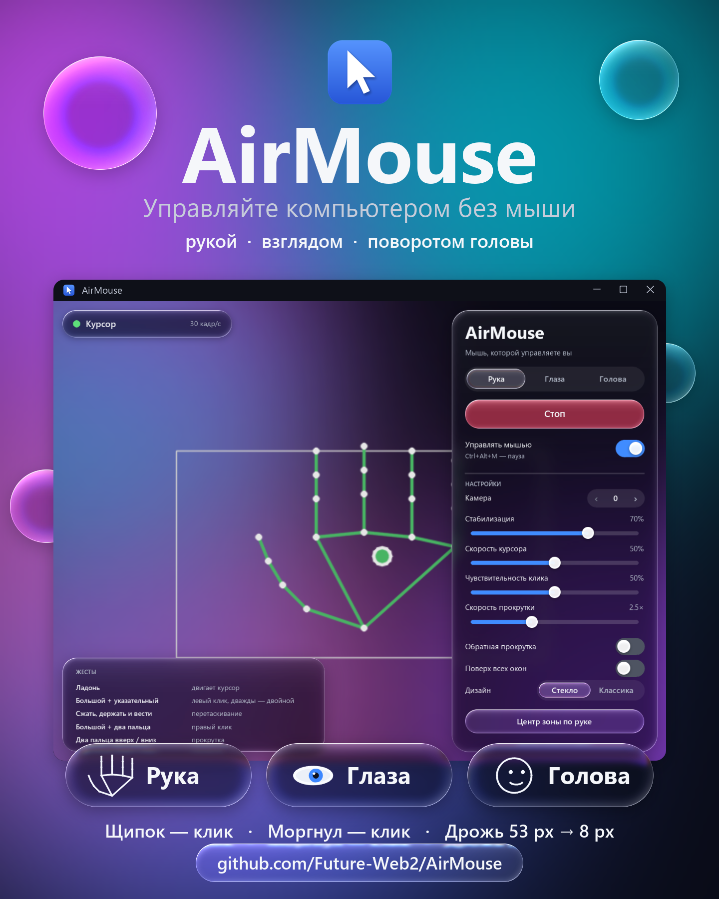

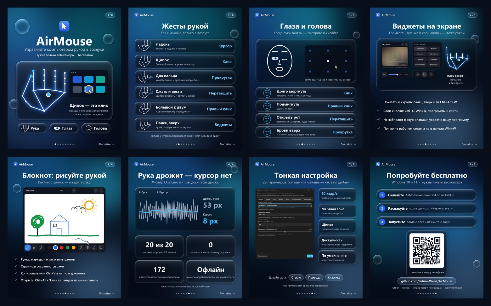

Ролики целиком сгенерированы скриптами:

- курсор в сценах с рукой двигает настоящий движок жестов, а в гайде им же двигается ползунок громкости на настоящих виджетах;
- график стабилизации построен на настоящих фильтрах;
- окна программы в роликах настоящие, они рисуются прямо в видео и не появляются на экране. Окно «Подробнее» показано по снимкам настоящего (`promo/guide/`, их делает `tools\capture_advanced.py`).

Пересобрать ролики:

```
.venv\Scripts\python.exe -m pip install imageio-ffmpeg
.venv\Scripts\python.exe promo\make_promo.py
.venv\Scripts\python.exe promo\make_guide.py
.venv\Scripts\python.exe promo\make_vertical.py
```

Отдельные кадры для проверки: `promo\make_guide.py --stills 8,30,60`.

## Жесты рукой (режим «Рука»)

| Жест | Действие |
|---|---|
| Двигать ладонью | Курсор |
| Коснуться большим пальцем указательного | Левый клик (два раза подряд — двойной клик) |
| Сжать, подержать и вести руку | Перетаскивание |
| Коснуться большим пальцем указательного и среднего | Правый клик |
| Поднять указательный и средний, остальные согнуть, вести вверх/вниз | Прокрутка |
| Сжать кулак, большой палец вверх, подержать полсекунды | Показать или скрыть виджеты |
| Сжать кулак, большой палец вниз, подержать секунду | Пауза, ещё раз — управление снова (одной рукой, без клавиатуры) |

## Две руки и доступность

AirMouse задуман и для тех, кому трудно пользоваться мышью: после травмы, при слабых или дрожащих руках, если работает одна рука или руки не работают совсем. И для тех, кому нужна точность без касания: учёных, инженеров, дизайнеров, преподавателей у доски. Можно поделить работу между двумя руками, щёлкать вообще без сведения пальцев или управлять глазами и головой.

**Две руки.** Когда в кадре обе руки, одна ведёт курсор, а другая работает как кнопки мыши. Курсор ведёт правая рука, это меняется в «Подробнее» → «Две руки». Целиться и нажимать можно разными руками, поэтому курсор не сбивается в момент клика. Ведущая рука умеет всё то же, что и одна.

| Вторая рука | Что произойдёт |
|---|---|
| Щипок (большой + указательный) | Левая кнопка: нажата, пока пальцы касаются. Короткий щипок — клик, два — двойной клик. Держать щипок и вести курсор ведущей рукой — перетаскивание |
| Большой палец к среднему | Правый клик |
| Два пальца вверх или вниз | Прокрутка |
| Буква «L»: указательный вверх, большой в сторону | **Точный курсор**: пока держите «L», курсор идёт в 3 раза медленнее руки — для мелких кнопок, ячеек таблиц, точек на графике, чертежей. Скорость настраивается |
| Быстрый взмах раскрытой ладонью | Команда на выбор: вперёд / назад, слайды презентации, рабочие столы Windows, треки. Выключено, пока не выбрано |
| Большой палец вверх, подержать | Развернуть активное окно, ещё раз — вернуть его размер |
| Большой палец вниз, подержать | Свернуть активное окно |

| Обе руки | Что произойдёт |
|---|---|
| Обе руки «V» (два пальца): развести / свести | **Масштаб** крупнее / мельче, как Ctrl + колесо: браузер, документы, карты, графики. Или экранная лупа Windows для тех, кто плохо видит |
| Ладони раскрыты, быстро развести руки | Все окна (Win+Tab): выбрать нужное окно щипком |
| Ладони раскрыты, быстро свести руки | Свернуть все окна (Win+D), ещё раз — вернуть их |
| Обе руки большим пальцем вверх, держать секунду | Пауза управления и продолжение. Работает и во время паузы, без клавиатуры |

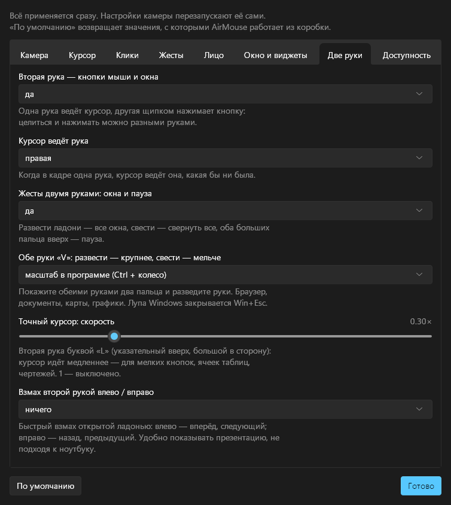

Окна самой AirMouse, рабочий стол и панель задач жесты окон не трогают. Жесты двумя руками срабатывают, только если обе руки движутся навстречу друг другу или в разные стороны, поэтому быстрое движение одной ведущей руки к ним не относится. Взмах второй рукой не срабатывает, когда рука только появилась в кадре.

**Точный курсор не прыгает.** Когда «L» отпущена, курсор остаётся там, куда прицелились, и щипок второй рукой сразу после этого попадает туда же. Разница между рукой и курсором тает постепенно, пока рука двигается дальше, а если показать рукой за край экрана, курсор сразу дойдёт до края.

**Пауза одной рукой.** Большой палец вниз ведущей рукой, подержать секунду: пауза, ещё раз — управление снова. Так паузу ставят и те, у кого работает одна рука.

**Клик задержкой** («Подробнее» → «Доступность»): наведите курсор и задержите его. Через заданное время, по умолчанию 1 секунду, он сам щёлкнет, а кольцо у курсора тем временем заполняется. Сводить пальцы не нужно. Следующий клик будет, когда курсор сдвинется и снова остановится. Клик задержкой работает и в режимах «Глаза» и «Голова».

Пока клик задержкой включён, на экране есть панель **«Клик задержкой»**: на ней выбирают, каким будет следующий клик — двойным, правым или перетаскиванием (первая задержка нажимает кнопку, следующая отпускает). Над самой панелью задержка всегда даёт обычный клик, поэтому выбирают её тоже задержкой. Так с компьютером можно работать совсем без рук, головой или взглядом.

Во вкладке «Две руки» вторую руку можно выключить, выбрать ведущую руку, выключить жесты окон, выбрать, что делает масштаб двумя руками, задать скорость точного курсора и команду взмаха. Во вкладке «Доступность» — пауза одной рукой, время клика задержкой и насколько курсор может сдвинуться.

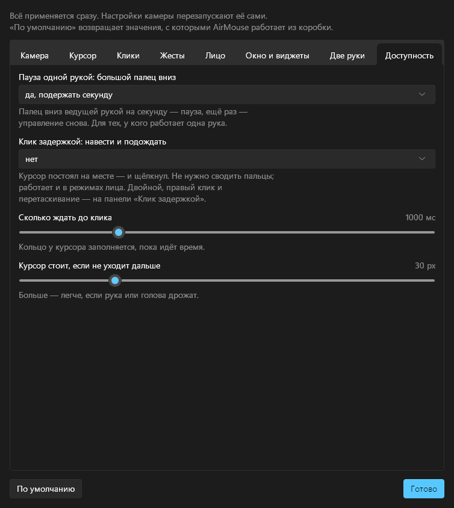

## Глаза и голова (режимы «Глаза» и «Голова»)

Курсор двигается так:

- **Глаза:** курсор переносится туда, куда вы смотрите, а лёгкий поворот головы точно его доводит. Веб-камера видит взгляд лишь примерно (обычно с точностью 100–200 px), поэтому доводка головой нужна, чтобы попадать в мелкие кнопки.
- **Голова:** курсор следует за поворотом головы. Это самый точный способ без рук. Кнопка «Центр по положению головы» задаёт, при каком положении головы курсор стоит в центре экрана.

Клики в обоих режимах одинаковые:

| Жест | Действие |
|---|---|
| Закрыть глаза примерно на полсекунды | Левый клик (два раза подряд — двойной клик) |
| Подмигнуть одним глазом | Правый клик |
| Открыть рот | Зажать левую кнопку (перетаскивание), закрыть рот — отпустить |
| Поднять брови и наклонить голову вверх/вниз | Прокрутка |

Обычное моргание кликом не считается. Пока глаза закрыты, курсор стоит на месте.

**Калибровка взгляда.** При первом запуске режима «Глаза» калибровка откроется сама и займёт около 25 секунд:

1. Смотрите на точку в центре и медленно поворачивайте голову. Так программа узнаёт, как ваши глаза компенсируют поворот.
2. Смотрите по очереди на 9 точек, держа голову ровно.

После калибровки внизу настроек будет показана её точность. Если сели иначе или изменился свет, просто повторите её. Индикаторы «Лицо» под превью показывают, насколько камера видит закрытые глаза, открытый рот и поднятые брови.

## Советы

- Камера должна видеть всю ладонь, рука примерно в 40–70 см от неё.
- Хороший свет делает трекинг стабильнее: при плохом освещении камера даёт только 15 кадров/с. Для режима «Глаза» особенно важно, чтобы свет падал на лицо спереди, а не из окна за спиной.
- **Центр зоны по руке:** нажмите кнопку и за 3 секунды поднимите руку в удобное положение. Рамка на превью — это зона, которая растягивается на весь экран.
- Курсор дрожит → увеличьте «Стабилизацию». Клик срабатывает сам → уменьшите «Чувствительность клика».
- Нужна максимальная точность → «Подробнее» → «Камера» → 60 кадр/с.

## Как работает стабилизация

1. Курсор следует за центром ладони, а не за кончиком пальца, поэтому щипок не сдвигает курсор.
2. Медиана по 3 кадрам отбрасывает одиночные сбои трекинга.
3. Фильтр One Euro сильно сглаживает медленные движения и почти не тормозит быстрые.
4. «Поводок»: курсор тянется за рукой на короткой нитке, и дрожание меньше её длины до экрана не доходит.
5. Пока пальцы сомкнуты, курсор стоит на месте, а клик попадает туда, где курсор был до начала щипка.

## Качество и KPI

У программы есть измеримые цели ([docs/KPI.md](docs/KPI.md)): размер архива, время до появления окна, нагрузка на процессор от интерфейса, точность курсора и кликов. В версии 1.1.0:

- архив 83 МБ вместо 124 МБ;
- повторный запуск открывает окно за 0,3 с вместо 0,9 с;
- окно Liquid Glass нагружает процессор в 2,3–2,6 раза меньше при той же картинке;
- курсор не дрожит у неподвижной руки, 20 щипков из 20 дают ровно один клик, ложных кликов нет.

В версии 1.2.0 появились виджеты на экране. Мини-панель с камерой перерисовывается примерно за 1 мс, кольцо у курсора — за 0,3 мс. Жест «палец вверх» срабатывает за 0,6 с и ни разу не сработал случайно от щипков, прокрутки или дрожащей руки.

В версии 1.3.0 появились 60 кадр/с камеры и ещё 22 параметра в «Подробнее». При 60 кадр/с KPI те же, что при 30: 20 щипков из 20 дают ровно 20 кликов, неподвижная рука не двигает курсор, ложных действий нет.

В версии 1.5.0 появились вторая рука, жесты двумя руками и клик задержкой: за минуту работы двумя руками ни одного ложного действия, 20 щипков второй рукой дают ровно 20 кликов, а курсор при этом сдвигается на 1 px.

В версии 1.4.0 появился блокнот. Во время рисования он перерисовывается за 4 мс при масштабе 150%. В автотесте линию рисует настоящий движок жестов: щипок, провести руку, разжать. Получается одна линия на всём пути и ни одного лишнего клика.

В версии 1.6.0 появились точный курсор, масштаб двумя руками, взмах-команда, пауза одной рукой, типы клика задержкой и английский язык. Точный курсор передаёт курсору 0,30 движения руки, а когда его отпускают, курсор сдвигается всего на 1 px. Каждый новый жест срабатывает ровно один раз и ничего не делает сам. Переведены все 302 строки интерфейса.

Замерить на своём компьютере: `AirMouse.exe --bench report.json`. KPI и остальную логику проверяют 223 автотеста, они запускаются в GitHub Actions на Windows и Ubuntu на каждый push.

## Ограничения

- Windows не даёт обычным программам управлять окнами, запущенными от имени администратора (например, Диспетчером задач). Чтобы управлять и ими, запустите AirMouse от имени администратора.
- Управление работает на основном мониторе (в Linux — на всём экране X11, все мониторы вместе).
- Настройки хранятся в `%APPDATA%\AirMouse\settings.json` (в Linux — `~/.config/AirMouse/settings.json`).
