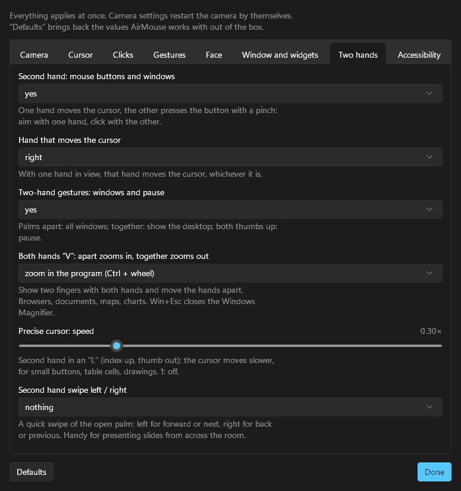
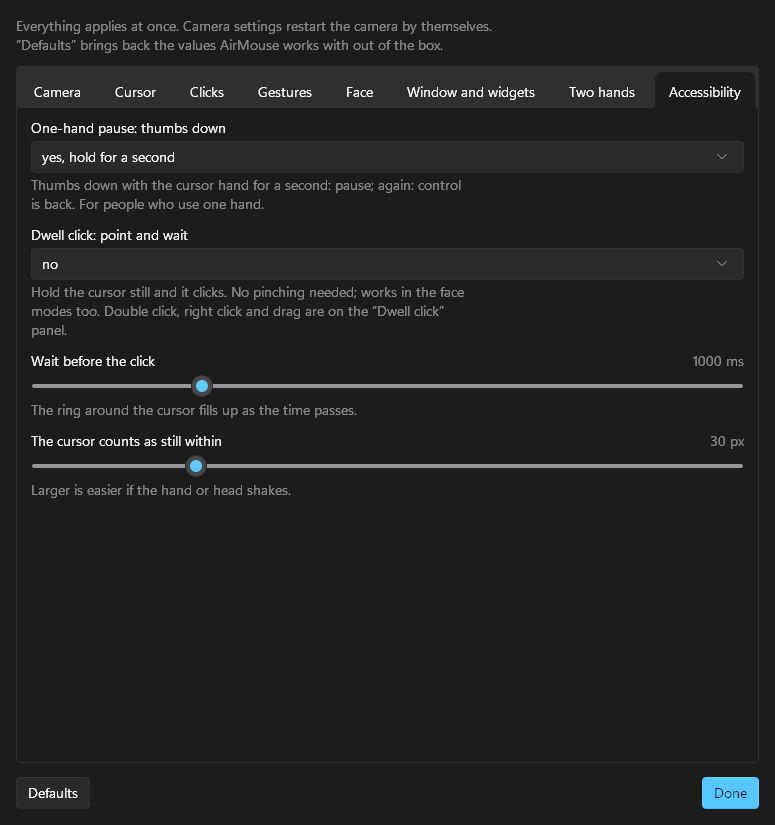
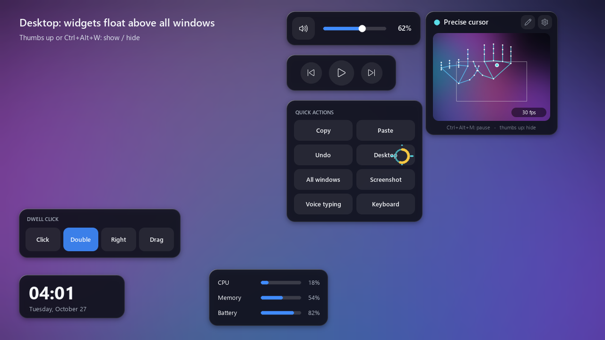
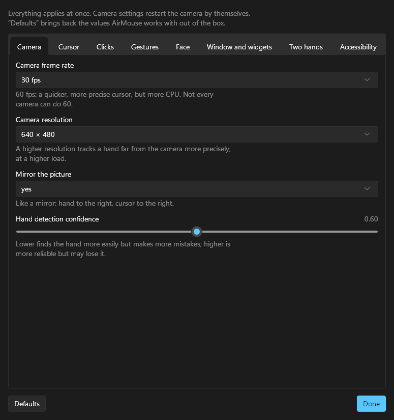
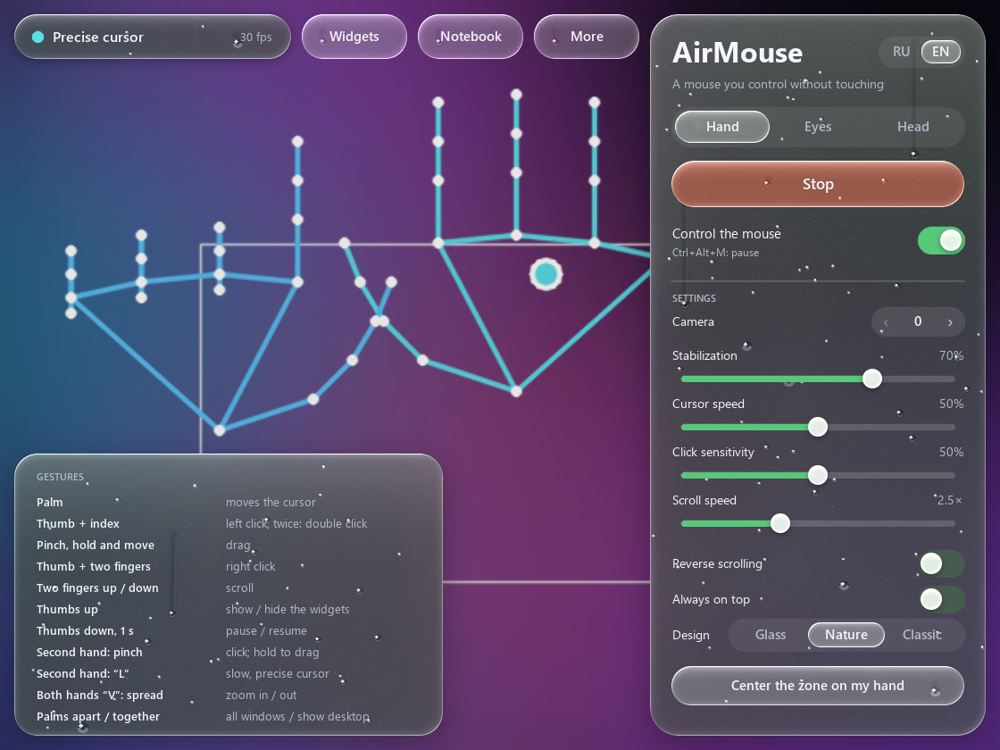

# How to use AirMouse

[Русский](GUIDE.md) · **English**

AirMouse controls the mouse through a webcam: with your hand, your gaze or a turn of your head. Here is everything step by step: installing, gestures, widgets, fine-tuning and what to do if something goes wrong.

## 1. Installing

You need Windows 10 or 11 (64-bit) and any webcam. No Python or other programs are needed.

1. Download **[AirMouse-windows-x64.zip](https://github.com/Future-Web2/AirMouse/releases/latest/download/AirMouse-windows-x64.zip)** (83 MB). All versions are on the [Releases](https://github.com/Future-Web2/AirMouse/releases) page.
2. Extract the whole archive: right-click the file → **“Extract All…”**. Run from inside the archive, the program cannot find its files.
3. Open the `AirMouse` folder and run **`AirMouse.exe`**.
4. If Windows shows “Windows protected your PC”, click **“More info” → “Run anyway”**. This is how Windows greets programs without a paid digital signature.

The `AirMouse` folder can go anywhere, but move it only as a whole.

## 2. First start

1. Pick the mode: **Hand**, **Eyes** or **Head**.
2. Press **“Start”**. In a couple of seconds the camera picture appears in the window.
3. Raise your hand, palm to the camera. The hand's points appear on the preview, and the cursor follows the palm.

Mouse control pauses with **Ctrl+Alt+M**, the “Control the mouse” switch, or a gesture: thumbs down, held for a second. The **“Stop”** button turns the camera off.

**Language.** The interface comes in English and Russian. The **RU | EN** switch is next to the AirMouse title; in the classic design it is the **“Язык · Language”** row. The window reopens in the chosen language at once, and the camera keeps running. On the first start AirMouse takes the language of Windows: Russian if Windows speaks Russian (or Belarusian, Kazakh, Kyrgyz, Tajik, Uzbek), English otherwise.

If the camera does not come on, close other programs that may hold it (Zoom, Teams, a browser with a call). Then check that **Settings → Privacy & security → Camera → “Let desktop apps access your camera”** is on in Windows. With several cameras, pick the right one with the arrows in the **“Camera”** row.

## 3. How to hold your hand

- **40–70 cm from the camera**, palm to the camera. The camera must see the whole palm.
- **Light from the front or the side.** Do not sit with your back to a window. In the dark the camera gives only 15 fps, and the cursor turns sluggish.
- **The frame on the preview is the whole screen.** The hand at the right edge of the frame puts the cursor at the right edge of the screen. No need to keep the frame in mind: just move the hand until the cursor is where you want it.
- **A comfortable place for the hand:** press **“Center the zone on my hand”** and within 3 seconds raise your hand where it is comfortable. The frame moves around it.
- **Hand tired?** Lower it: the cursor stays where it is. When the hand comes back, the cursor does not jump but glides over to it.

The cursor follows the center of the palm, not a finger, so a pinch does not move it. While the fingers touch, the cursor stays still.

## 4. Hand gestures

| Gesture | How | What happens |
|---|---|---|
| Palm | Move the open palm | Cursor |
| Pinch | Touch the thumb to the index finger and open | Left click. Two pinches in a row: double click |
| Pinch and move | Bring thumb and index together, hold and move the hand. Open to let go | Drag, select text |
| Thumb + two fingers | Touch the thumb to the index and middle fingers at once | Right click |
| Two fingers | Raise the index and middle fingers, fold the rest, move the hand up or down | Scroll |
| Thumbs up | Fist, thumb up, hold for half a second | Show or hide the widgets |
| Thumbs down | Fist, thumb down, hold for a second | Pause; again: control is back. One hand, no keyboard |

**The ring around the cursor** shows what AirMouse sees. It fills up while the fingers close, flashes on a click and shows arrows while scrolling. It tells you a click is about to happen.

In the main window:

- the cursor shakes → move **“Stabilization”** to the right;
- the hand has to travel far → move **“Cursor speed”** to the right (the frame gets smaller);
- clicks happen by themselves → move **“Click sensitivity”** to the left; if clicking is hard, to the right;
- scrolling is too fast or too slow → **“Scroll speed”**; **“Reverse scrolling”** flips the direction.

### Two hands: one aims, the other presses

With both hands in view, the cursor hand (the right one; change it in “More” → “Two hands”) moves the cursor and the other works as the mouse buttons. Aiming and pressing with different hands is easier: the cursor does not slip at the moment of the click, and you do not have to hold a pinch while moving. The cursor hand can still do everything by itself.

| Second hand | What happens |
|---|---|
| Pinch | Left button down while the fingers touch: a quick pinch is a click, two a double click, holding drags |
| Thumb to the middle finger | Right click |
| Two fingers up or down | Scroll |
| An “L”: index up, thumb out to the side, the other fingers folded | **Precise cursor**: while you hold the “L”, the cursor moves 3 times slower than the hand. For small buttons, table cells, points on a chart, drawings |
| A quick swipe of the open palm left or right | A command of your choice (off until one is picked): forward / back in a browser, slides, Windows desktops, tracks |
| Thumbs up, hold | Maximize the active window; again: restore its size |
| Thumbs down, hold | Minimize the active window |

| Both hands | What happens |
|---|---|
| Both hands “V” (two fingers), apart | **Zoom** in; together: zoom out. In browsers, documents, maps, charts, like Ctrl + wheel. Can be switched to the Windows Magnifier |
| Open palms, move the hands apart quickly | All windows: pick one with a pinch |
| Open palms, bring the hands together quickly | Minimize all windows; again: bring them back |
| Both thumbs up, hold for a second | Pause and resume, without a keyboard |

**The precise cursor does not jump.** When you let go of the “L”, the cursor stays where you aimed, and a pinch of the second hand right after clicks exactly there. The difference between the hand and the cursor fades as the hand moves on. Pointing past an edge of the screen takes the cursor to that edge.

**The second-hand swipe** is switched on in “More” → “Two hands” → “Second hand swipe left / right”. A swipe to the left is forward or the next slide, to the right back or the previous one. Handy for presenting while standing at the screen. A swipe does not count while the hand is just coming into view, nor while both hands spread apart: that is the “all windows” gesture.

With one hand in view, that hand moves the cursor, whichever it is. So AirMouse suits people with one working hand too, including the left one. The same hand pauses and resumes: thumbs down, held for a second.

### Dwell click: no pinching

If bringing the fingers together is hard, switch on “More” → “Accessibility” → **“Dwell click”**. Point the cursor and hold it still: after a second (the time can be set) it clicks by itself, and the ring around the cursor fills up meanwhile. The next click comes when the cursor moves and stops again. The dwell click works in the “Eyes” and “Head” modes too.

While the dwell click is on, the **“Dwell click”** panel is on the screen. It picks what the next click is:

| Button | The next dwell |
|---|---|
| Click | An ordinary left click (always, unless something else is picked) |
| Double | A double click: open a file or a folder |
| Right | A right click: the context menu |
| Drag | The first dwell presses the button, the next lets it go: drag a file or a window, select text |

Double, right and drag last for one click, then it is an ordinary click again. Over the panel itself a dwell is always a plain click, so you pick by simply holding the cursor on it. This way the computer can be used with no hands at all, by head or by gaze.

## 5. On-screen widgets

While AirMouse runs, its widgets float above all windows: a mini window with the camera, the volume, music and video, a panel of quick buttons, and on request a clock and the computer load. The “Dwell click” panel shows while the dwell click is on.

- **Show or hide:** hold a **thumbs up** for half a second or press **Ctrl+Alt+W**.
- **Use them by hand**, like an ordinary mouse. A pinch presses a button. To move the volume slider, pinch on the slider and move the hand. To move the widget itself, pinch on an empty spot of the widget and move. The scroll gesture over the volume changes it.
- **Widgets never take the focus.** The “Copy” button presses Ctrl+C in the program you are working in. “Keyboard” opens the Windows on-screen keyboard, to type by hand.
- **Your own buttons:** the **“Widgets”** button in the AirMouse window opens the editor. There you switch widgets on and off and make button panels with up to 12 buttons each. A button can press a key combination (`ctrl+c`, `win+d`, `alt+tab`, `ctrl+shift+esc`, `f5`, `playpause`, `volumeup`) or open a program (`notepad`, `calc`), a website (`https://…`) or a file.
- **Widgets without the camera:** “More” → “Window and widgets” → **“Widgets on screen even with the camera off” → “yes, always”**. Then they are handy with an ordinary mouse too.
- **Size:** “More” → “Window and widgets” → “On-screen widget size”.

**Why AirMouse widgets are not in Win+W.** The Windows 11 widget board (Win+W) only takes programs installed from a signed MSIX package, for example from the Microsoft Store. AirMouse comes as an ordinary archive, so its widgets live right on the desktop, above the windows. A thumbs up or Ctrl+Alt+W shows them.

### Notebook: draw by hand

A scratch pad like Paint, above all windows. It opens with the **“Notebook”** button in the AirMouse window, the **pen** on the AirMouse mini panel (reachable by hand) or **Ctrl+Alt+N**. It closes the same way, or with the cross on the notebook.

1. Point the cursor at the paper.
2. Bring the thumb and the index finger together and move the hand: a line is drawn.
3. Open the fingers: the line ends. A quick pinch makes a dot.

| Button | What it does |
|---|---|
| Pen, marker, eraser | Thin line, thick line, erase |
| Five circles | Colour: graphite, blue, red, green, yellow. Picking a colour puts the eraser away |
| Back arrow | Undo the last line (and clearing the page) |
| Bin | Clear the page |
| Two sheets | Copy the page as a picture: then Ctrl+V into a chat, a document or an email |
| Folder | Open the folder with the pages |
| ‹ › and + | Turn the pages and add a new one |
| Corner arrows | Make the notebook nearly as big as the screen, and back |

Pages save themselves a second after a change, in `%APPDATA%\AirMouse\notebook` (PNG pictures), and open again next time. The notebook works with the camera off too; then you draw with the mouse.

For smoother lines, move **“Stabilization”** to the right. For a line that starts right after the pinch, lower “More” → “Clicks” → **“Movement that starts a drag”** to 10 px.

## 6. Eyes and head: no hands

- **Eyes:** the cursor jumps to where you look, and a slight turn of the head brings it exactly onto the target. The first time the mode starts, the calibration opens, about 25 seconds. First look at the dot in the center and slowly turn your head, then at 9 dots one after another, keeping your head still. If you sit differently or the light changes, press “Gaze calibration” again.
- **Head:** the cursor follows the turn of the head. This is the most precise way without hands. **“Center on my head position”** sets which head position puts the cursor in the middle of the screen.

| Gesture | What happens |
|---|---|
| Close the eyes for about half a second | Left click. Twice: double click |
| Wink one eye | Right click |
| Open the mouth | Hold the button (drag). Close the mouth to let go |
| Raise the brows and tilt the head up or down | Scroll |

An ordinary blink is not a click. The “Left eye”, “Right eye”, “Mouth” and “Brows” meters on the “Face” card show how well the camera sees each gesture. Their thresholds are set in “More” → “Face”.

## 7. “More”: fine-tuning

The **“More”** button at the top of the window (in the classic design, “More…”) opens 33 parameters on eight tabs. Everything applies at once, and camera settings restart the camera by themselves. **“Defaults”** brings back the values AirMouse works with out of the box.

### Camera

| Parameter | Default | Range | What it changes |
|---|---|---|---|
| Camera frame rate | 30 fps | 30 / **60 fps** | 60 fps: a quicker, more precise cursor, but more CPU. Not every camera can do 60 |
| Camera resolution | 640 × 480 | 640 × 480 / 1280 × 720 | A higher resolution tracks a hand far from the camera more precisely, at a higher load |
| Mirror the picture | yes | yes / no | Like a mirror: hand to the right, cursor to the right |
| Hand detection confidence | 0.60 | 0.30 … 0.90 | Lower finds the hand more easily but makes more mistakes; higher is more reliable but may lose it |

### Cursor

| Parameter | Default | Range | What it changes |
|---|---|---|---|
| Cursor dead zone | 1.00× | 0 … 3.00× | Shaking smaller than this zone does not move the cursor. 0: the cursor follows every movement |
| Response to fast movements | 1.00× | 0.25× … 3.00× | Higher: fast movements with almost no lag; lower: smoother |
| Drop single-frame camera glitches | yes | yes / no | A median of three frames: removes jumps, adds one frame of delay |
| Smooth cursor glide | 150 ms | 0 … 500 ms | When the hand appears, the cursor glides over in this time instead of jumping |

### Clicks

| Parameter | Default | Range | What it changes |
|---|---|---|---|
| Pinch confirmation | 30 ms | 0 … 250 ms | How long the fingers must touch to count. Longer: fewer accidental clicks |
| Open the fingers to release | 1.50× | 1.10× … 2.50× | How many times farther than the touch threshold the fingers must part to release the button |
| Time for a right click | 120 ms | 40 … 400 ms | How long to wait for the middle finger to join (then it is a right click) |
| Cursor stays still after a click | 500 ms | 0 … 1500 ms | So that the second pinch of a double click lands on the same spot |
| Movement that starts a drag | 30 px | 5 … 120 px | How far to move the pinching hand to start a drag |

### Gestures

| Parameter | Default | Range | What it changes |
|---|---|---|---|
| Scroll step | 30 | 10 … 120 | Smaller: smoother scrolling; larger: faster (120 = one wheel notch) |
| Hold the thumbs up | 500 ms | 200 … 1500 ms | How long to hold a thumbs up to show or hide the widgets |
| Wait for a lost hand | 300 ms | 100 … 1500 ms | If the hand leaves the picture for a moment, a held button stays down this long |

### Face

| Parameter | Default | Range | What it changes |
|---|---|---|---|
| An eye counts as closed at | 0.55 | 0.30 … 0.90 | The threshold on the “Left / Right eye” meters |
| Wink for a right click | 300 ms | 150 … 800 ms | How long to keep one eye closed |
| The mouth counts as open at | 0.45 | 0.20 … 0.80 | The threshold on the “Mouth” meter: open the mouth to hold the button |
| The brows count as raised at | 0.50 | 0.20 … 0.90 | The threshold on the “Brows” meter: raise the brows to scroll |

### Window and widgets

| Parameter | Default | Range | What it changes |
|---|---|---|---|
| AirMouse window frame rate | 30 fps | 30 / 60 fps | 60: a smoother window, a higher load. Mouse control is not affected |
| On-screen widget size | 1.00× | 0.75× … 1.50× | Larger: easier to hit by hand |
| Widgets on screen even with the camera off | no | no / yes, always | The widgets stay on the screen without the camera |

### Two hands

| Parameter | Default | Range | What it changes |
|---|---|---|---|
| Second hand: mouse buttons and windows | yes | yes / no | One hand moves the cursor, the other presses the buttons. The camera restarts by itself |
| Hand that moves the cursor | right | right / left | Which of the two hands moves the cursor. A single hand in view always does |
| Two-hand gestures: windows and pause | yes | yes / no | Palms apart: all windows; together: show the desktop; both thumbs up: pause |
| Both hands “V”: apart zooms in, together zooms out | zoom in the program | in the program / Windows Magnifier / off | In the program: like Ctrl + wheel. The Windows Magnifier enlarges the whole screen; Win+Esc closes it |
| Precise cursor: speed | 0.30× | 0.10× … 1.00× | How much of the hand's movement reaches the cursor while the second hand shows an “L”. 1: off |
| Second hand swipe left / right | nothing | forward / back, slides, desktops, tracks | What a quick swipe of the second hand's open palm does |

### Accessibility

| Parameter | Default | Range | What it changes |
|---|---|---|---|
| One-hand pause: thumbs down | yes | yes / no | Thumbs down with the cursor hand for a second: pause; again: control is back |
| Dwell click: point and wait | no | no / yes | Hold the cursor still and it clicks. Which click: on the “Dwell click” panel |
| Wait before the click | 1000 ms | 400 … 3000 ms | Shorter: faster; longer: fewer accidental clicks |
| The cursor counts as still within | 30 px | 10 … 100 px | Larger is easier if the hand or head shakes |

### Ready recipes

| Goal | What to set |
|---|---|
| Maximum precision | Camera → **60 fps**. If you sit far from the camera, also **1280 × 720**. The real camera frame rate shows in the “Session” card |
| Less load on a slow computer | 30 fps, 640 × 480, window frame rate 30 fps |
| A cursor without shaking | Dead zone 1.5–2×, response 0.7× |
| A cursor without lag | Dead zone 0.5×, response 1.5–2×, “Drop glitches” → no |
| Fewer accidental clicks | Pinch confirmation 60–100 ms, “Open the fingers” 1.8× |
| An easier double click | “Cursor stays still after a click” 700–900 ms |
| Fewer right clicks instead of left | “Time for a right click” 60–80 ms |
| The hand gets lost less | More light, detection confidence 0.45–0.5 |
| An easier wink | “An eye counts as closed at” 0.45–0.5 |
| Click without pinching | “Dwell click” → yes, time 800–1500 ms |
| The hand shakes, but the aim must be precise | The second hand presses, the cursor hand only aims; “Dead zone” 1.5×; for small targets, the second hand in an “L” |
| Only the left hand works | “Hand that moves the cursor” → left (a single hand in view moves the cursor anyway) |
| Work with no hands at all | “Head” mode, “Dwell click” → yes; double click, right click and drag on the “Dwell click” panel |
| Small text is hard to see | “Both hands V” → Windows Magnifier: spread the hands to enlarge the screen |
| Tables, charts, drawings | The second hand in an “L” for precise aim, “Precise cursor: speed” 0.2–0.3×; zoom with both hands “V” |
| Presenting slides | “Second hand swipe” → slides: swipe left for the next slide, right for the previous one |

## 8. Design

Pick the design in the main window, in the **“Design”** row. The window reopens in the new look at once, and the camera keeps running.

- **Glass**: clear liquid glass over violet light.
- **Nature**: fogged glass with drops of condensation over a deep green backdrop with sunlight glints. The on-screen widgets turn green with drops too.
- **Classic**: the standard Windows 11 controls, a light or dark theme as in the system.

## 9. If something goes wrong

| Problem | What to do |
|---|---|
| The camera does not come on | Close other programs using the camera. Let desktop apps access the camera in the Windows settings. Pick another camera in the “Camera” row |
| Only 15 fps | Too little light. Turn on a light in front of you |
| The cursor shakes | “Stabilization” to the right, or a larger “Cursor dead zone” |
| The cursor does not reach the edge of the screen | “Cursor speed” to the right, or “Center the zone on my hand” |
| Clicks happen by themselves | “Click sensitivity” to the left, a longer “Pinch confirmation” |
| Clicking does not work | “Click sensitivity” to the right. Open the fingers a little wider |
| The cursor cannot control the Task Manager | Windows does not let ordinary programs control administrator windows. Run AirMouse as administrator |
| The cursor is only on one monitor | Control works on the main monitor |
| The widgets are not in Win+W | That is by design, see section 5. AirMouse widgets live on the screen itself |
| The cursor suddenly got slow | The second hand shows an “L”: that is the precise cursor. Lower the hand or open the fingers |
| The interface is in the wrong language | The RU / EN switch next to the AirMouse title; in the classic design, the “Язык · Language” row |
| You need to stop right now | Ctrl+Alt+M (pause), a thumbs down for a second, or lower your hand |

## 10. Hotkeys and data

- **Ctrl+Alt+M**: pause and resume the control. Without a keyboard: a thumbs down held for a second, or both thumbs up.
- **Ctrl+Alt+W**: show or hide the widgets.
- **Ctrl+Alt+N**: open or close the notebook.
- The camera picture is processed right on the computer and is never sent anywhere.
- The settings are in `%APPDATA%\AirMouse\settings.json`.
