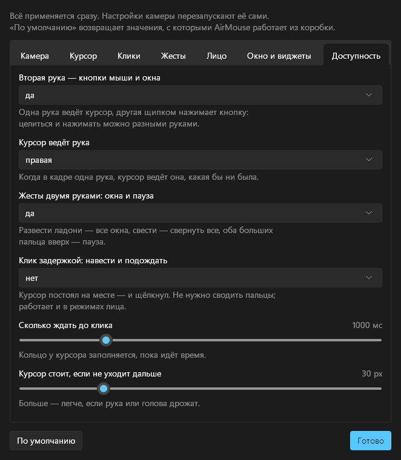
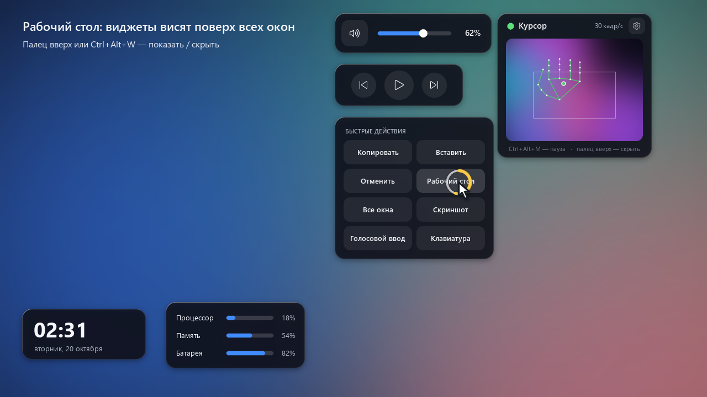
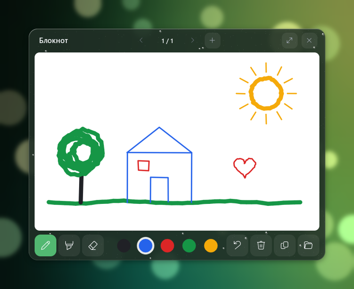
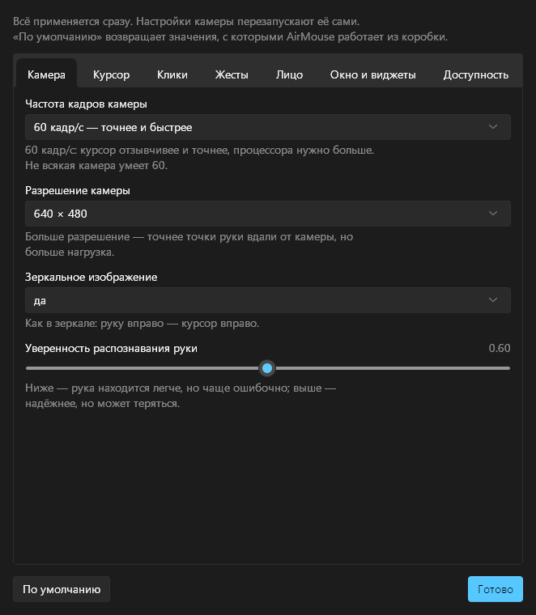
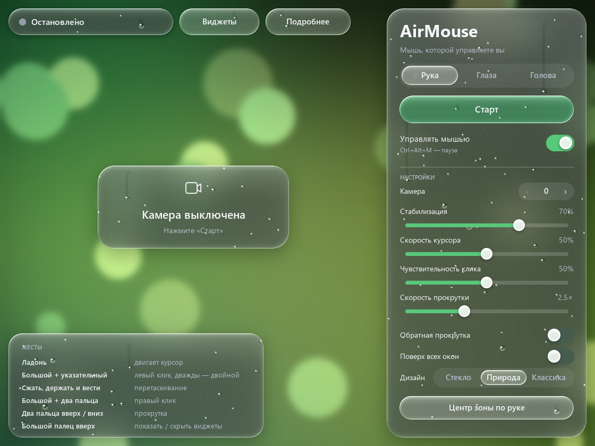

# Как пользоваться AirMouse

AirMouse управляет мышью через веб-камеру: рукой, взглядом или поворотом головы. Здесь всё по шагам: установка, жесты, виджеты, точная настройка и что делать, если что-то идёт не так.

**Видео-гайд:** [`promo/AirMouse_guide.mp4`](../promo/AirMouse_guide.mp4), 1920×1080, с музыкой и подписями. Звук не нужен: всё сказано в подписях.

## 1. Установка

Нужны Windows 10 или 11 (64-бит) и любая веб-камера. Python и другие программы не нужны.

1. Скачайте **[AirMouse-windows-x64.zip](https://github.com/Future-Web2/AirMouse/releases/latest/download/AirMouse-windows-x64.zip)** (83 МБ). Все версии лежат на странице [Releases](https://github.com/Future-Web2/AirMouse/releases).
2. Распакуйте архив целиком: правой кнопкой по файлу → **«Извлечь все…»**. Если запускать программу прямо из архива, она не найдёт свои файлы.
3. Откройте папку `AirMouse` и запустите **`AirMouse.exe`**.
4. Если Windows покажет «Система Windows защитила ваш компьютер», нажмите **«Подробнее» → «Выполнить в любом случае»**. Так Windows встречает программы без платной цифровой подписи.

Папку `AirMouse` можно положить куда угодно, но переносить её нужно только целиком.

## 2. Первый запуск

1. Выберите режим: **Рука**, **Глаза** или **Голова**.
2. Нажмите **«Старт»**. Через пару секунд в окне появится изображение с камеры.
3. Поднимите руку ладонью к камере. На превью появятся точки руки, и курсор пойдёт за ладонью.

Управление мышью ставится на паузу клавишами **Ctrl+Alt+M** или переключателем «Управлять мышью». Кнопка **«Стоп»** выключает камеру.

Если камера не включается, закройте другие программы, которые могут её занимать (Zoom, Teams, браузер со звонком). Затем проверьте, что в Windows включено **Параметры → Конфиденциальность и защита → Камера → «Разрешить классическим приложениям доступ к камере»**. Если камер несколько, выберите нужную стрелками в строке **«Камера»**.

## 3. Как держать руку

- **40–70 см от камеры**, ладонью к камере. Камера должна видеть всю ладонь.
- **Свет спереди или сбоку.** Не садитесь спиной к окну. В темноте камера даёт только 15 кадров/с, и курсор становится вялым.
- **Рамка на превью — это весь экран.** Рука у правого края рамки — курсор у правого края экрана. Рамку не нужно держать в голове: просто двигайте руку, пока курсор не окажется где нужно.
- **Удобное место для руки:** нажмите **«Центр зоны по руке»** и за 3 секунды поднимите руку туда, где ей удобно. Рамка встанет вокруг неё.
- **Рука устала?** Опустите её: курсор останется на месте. Когда рука вернётся, курсор не прыгнет, а плавно перелетит к ней.

Курсор следует за центром ладони, а не за пальцем, поэтому щипок не сдвигает курсор. Пока пальцы сомкнуты, курсор стоит на месте.

## 4. Жесты рукой

| Жест | Как сделать | Что произойдёт |
|---|---|---|
| Ладонь | Двигайте раскрытой ладонью | Курсор |
| Щипок | Коснитесь большим пальцем указательного и разожмите | Левый клик. Два щипка подряд — двойной клик |
| Сжать и вести | Сомкните большой и указательный, подержите и ведите руку. Разожмите — отпустить | Перетаскивание, выделение текста |
| Большой + два пальца | Коснитесь большим пальцем сразу указательного и среднего | Правый клик |
| Два пальца | Поднимите указательный и средний, остальные согните, ведите руку вверх или вниз | Прокрутка |
| Палец вверх | Кулак, большой палец вверх, держите полсекунды | Показать или скрыть виджеты |

**Кольцо у курсора** показывает, что видит AirMouse. Пока пальцы сходятся, оно заполняется, при клике вспыхивает, а при прокрутке показывает стрелки. По нему видно, что клик вот-вот случится.

В главном окне:

- курсор дрожит → сдвиньте вправо **«Стабилизация»**;
- руку приходится далеко водить → сдвиньте вправо **«Скорость курсора»** (рамка станет меньше);
- клик срабатывает сам → сдвиньте влево **«Чувствительность клика»**, а если клик срабатывает с трудом, то вправо;
- прокрутка слишком быстрая или медленная → **«Скорость прокрутки»**, направление меняет **«Обратная прокрутка»**.

### Две руки: одна целится, другая нажимает

Когда в кадре обе руки, ведущая рука (правая, это меняется в «Подробнее» → «Доступность») двигает курсор, а вторая работает как кнопки мыши. Целиться и нажимать разными руками проще: курсор не сбивается в момент клика, и не нужно держать щипок, пока ведёте руку. Ведущая рука по-прежнему умеет всё сама.

| Вторая рука | Что произойдёт |
|---|---|
| Щипок | Левая кнопка нажата, пока пальцы касаются: короткий щипок — клик, два — двойной, держать — перетаскивание |
| Большой палец к среднему | Правый клик |
| Два пальца вверх или вниз | Прокрутка |
| Большой палец вверх, подержать | Развернуть активное окно, ещё раз — вернуть размер |
| Большой палец вниз, подержать | Свернуть активное окно |

| Обе руки, ладони раскрыты | Что произойдёт |
|---|---|
| Быстро развести руки | Все окна: выберите нужное щипком |
| Быстро свести руки | Свернуть все окна, ещё раз — вернуть |
| Обе руки большим пальцем вверх, держать секунду | Пауза и продолжение, без клавиатуры |

Если в кадре одна рука, курсор ведёт она, какая бы ни была. Поэтому AirMouse подходит и тем, у кого работает одна рука, в том числе левая.

### Клик задержкой: без щипка

Если сводить пальцы трудно, включите «Подробнее» → «Доступность» → **«Клик задержкой»**. Наведите курсор и задержите его: через секунду (время настраивается) он сам щёлкнет, а кольцо у курсора тем временем заполнится. Следующий клик будет, когда курсор сдвинется и снова остановится. Клик задержкой работает и в режимах «Глаза» и «Голова». Правый клик и перетаскивание тогда удобно делать второй рукой или жестами лица.

## 5. Виджеты на экране

Пока AirMouse работает, поверх всех окон висят его виджеты: мини-окно с камерой, громкость, музыка и видео, панель быстрых кнопок, а по желанию часы и нагрузка компьютера.

- **Показать или скрыть:** подержите **большой палец вверх** полсекунды или нажмите **Ctrl+Alt+W**.
- **Управляют ими рукой**, как обычной мышью. Щипок нажимает кнопку. Чтобы двигать ползунок громкости, сожмите пальцы на ползунке и ведите руку. Чтобы переставить сам виджет, сожмите пальцы на пустом месте виджета и ведите. Жест прокрутки над громкостью меняет её.
- **Виджеты не забирают фокус.** Кнопка «Копировать» нажимает Ctrl+C в той программе, где вы работаете. «Клавиатура» открывает экранную клавиатуру Windows, чтобы печатать рукой.
- **Свои кнопки:** кнопка **«Виджеты»** в окне AirMouse открывает редактор. Там включают и выключают виджеты и создают панели кнопок, до 12 кнопок в каждой. Кнопка может нажать сочетание клавиш (`ctrl+c`, `win+d`, `alt+tab`, `ctrl+shift+esc`, `f5`, `playpause`, `volumeup`) или открыть программу (`notepad`, `calc`), сайт (`https://…`) или файл.
- **Виджеты и без камеры:** «Подробнее» → «Окно и виджеты» → **«Виджеты на экране, даже когда камера выключена» → «да, всегда»**. Тогда ими удобно пользоваться и обычной мышью.
- **Размер:** «Подробнее» → «Окно и виджеты» → «Размер виджетов на экране».

**Почему виджетов AirMouse нет в Win+W.** Панель виджетов Windows 11 (Win+W) принимает только программы, установленные подписанным пакетом MSIX, например из Microsoft Store. AirMouse распространяется обычным архивом, поэтому его виджеты живут прямо на рабочем столе, поверх окон. Их показывает большой палец вверх или Ctrl+Alt+W.

### Блокнот: рисовать рукой

Черновик, как Paint, поверх всех окон. Открывается кнопкой **«Блокнот»** в окне AirMouse, **карандашом** на мини-панели AirMouse (до него можно дотянуться рукой) или клавишами **Ctrl+Alt+N**. Закрывается так же или крестиком на блокноте.

1. Наведите курсор на бумагу.
2. Сожмите большой и указательный пальцы и ведите руку — рисуется линия.
3. Разожмите пальцы — линия закончилась. Короткий щипок ставит точку.

| Кнопка | Что делает |
|---|---|
| Ручка, маркер, ластик | Тонкая линия, толстая линия, стереть |
| Пять кружков | Цвет: графит, синий, красный, зелёный, жёлтый. Выбор цвета убирает ластик |
| Стрелка назад | Отменить последнюю линию (и очистку страницы) |
| Корзина | Очистить страницу |
| Два листа | Скопировать страницу картинкой: потом Ctrl+V в чат, документ или письмо |
| Папка | Открыть папку, где лежат страницы |
| ‹ › и + | Листать страницы и добавить новую |
| Стрелки в углу | Развернуть блокнот почти на весь экран и обратно |

Страницы сохраняются сами, через секунду после изменения, в `%APPDATA%\AirMouse\notebook` (картинки PNG) и открываются в следующий раз. Блокнот работает и при выключенной камере, тогда рисуют мышью.

Чтобы линии были ровнее, сдвиньте **«Стабилизацию»** правее. Чтобы линия начиналась сразу после щипка, уменьшите «Подробнее» → «Клики» → **«Сдвиг для начала перетаскивания»** до 10 px.

## 6. Глаза и голова: без рук

- **Глаза:** курсор переносится туда, куда вы смотрите, а лёгкий поворот головы точно доводит его. При первом запуске режима откроется калибровка, около 25 секунд. Сначала смотрите на точку в центре и медленно поворачивайте голову, затем по очереди на 9 точек, держа голову ровно. Если сели иначе или изменился свет, нажмите «Калибровка взгляда» ещё раз.
- **Голова:** курсор следует за поворотом головы. Это самый точный способ без рук. **«Центр по положению головы»** задаёт, при каком положении головы курсор стоит в центре экрана.

| Жест | Что произойдёт |
|---|---|
| Закрыть глаза примерно на полсекунды | Левый клик. Дважды — двойной клик |
| Подмигнуть одним глазом | Правый клик |
| Открыть рот | Зажать кнопку (перетаскивание). Закрыть рот — отпустить |
| Поднять брови и наклонить голову вверх или вниз | Прокрутка |

Обычное моргание кликом не считается. Шкалы «Левый глаз», «Правый глаз», «Рот», «Брови» в карточке «Лицо» показывают, насколько камера видит каждый жест. Пороги для них настраиваются в «Подробнее» → «Лицо».

## 7. «Подробнее»: точная настройка

Кнопка **«Подробнее»** вверху окна (в классическом дизайне — «Подробнее…») открывает 29 параметров в семи вкладках. Всё применяется сразу, а настройки камеры перезапускают её сами. **«По умолчанию»** возвращает значения, с которыми AirMouse работает из коробки.

### Камера

| Параметр | Обычно | Можно | Что меняет |
|---|---|---|---|
| Частота кадров камеры | 30 кадр/с | 30 / **60 кадр/с** | 60 кадр/с: курсор отзывчивее и точнее, процессора нужно больше. Не всякая камера умеет 60 |
| Разрешение камеры | 640 × 480 | 640 × 480 / 1280 × 720 | Больше разрешение — точнее точки руки вдали от камеры, но больше нагрузка |
| Зеркальное изображение | да | да / нет | Как в зеркале: руку вправо — курсор вправо |
| Уверенность распознавания руки | 0.60 | 0.30 … 0.90 | Ниже — рука находится легче, но чаще ошибочно; выше — надёжнее, но может теряться |

### Курсор

| Параметр | Обычно | Можно | Что меняет |
|---|---|---|---|
| Мёртвая зона курсора | 1.00× | 0 … 3.00× | Дрожь меньше этой зоны не двигает курсор. 0 — курсор ловит каждое движение |
| Отзывчивость к быстрым движениям | 1.00× | 0.25× … 3.00× | Больше — быстрые движения почти без задержки, меньше — плавнее |
| Отбрасывать одиночные сбои камеры | да | да / нет | Медиана из трёх кадров: убирает рывки, добавляет задержку в один кадр |
| Плавный перелёт курсора | 150 мс | 0 … 500 мс | Когда рука появляется, курсор не прыгает, а перелетает за это время |

### Клики

| Параметр | Обычно | Можно | Что меняет |
|---|---|---|---|
| Подтверждение щипка | 30 мс | 0 … 250 мс | Сколько пальцы должны касаться, чтобы это засчиталось. Больше — меньше случайных кликов |
| Разжать пальцы для отпускания | 1.50× | 1.10× … 2.50× | Во сколько раз дальше порога касания нужно развести пальцы, чтобы отпустить кнопку |
| Время на правый клик | 120 мс | 40 … 400 мс | Сколько ждать, не присоединится ли средний палец (тогда клик правый) |
| Курсор стоит после клика | 500 мс | 0 … 1500 мс | Чтобы второй щипок двойного клика попал в то же место |
| Сдвиг для начала перетаскивания | 30 px | 5 … 120 px | Насколько сдвинуть руку с зажатыми пальцами, чтобы началось перетаскивание |

### Жесты

| Параметр | Обычно | Можно | Что меняет |
|---|---|---|---|
| Шаг прокрутки | 30 | 10 … 120 | Мельче — плавнее прокрутка, крупнее — быстрее (120 = одно деление колеса) |
| Удерживать «палец вверх» | 500 мс | 200 … 1500 мс | Сколько держать большой палец вверх, чтобы показать или скрыть виджеты |
| Ждать пропавшую руку | 300 мс | 100 … 1500 мс | Если рука на миг пропала из кадра, нажатая кнопка не отпускается это время |

### Лицо

| Параметр | Обычно | Можно | Что меняет |
|---|---|---|---|
| Глаз считается закрытым при | 0.55 | 0.30 … 0.90 | Порог по шкале «Левый / правый глаз» |
| Подмигнуть для правого клика | 300 мс | 150 … 800 мс | Сколько держать один глаз закрытым |
| Рот открыт при | 0.45 | 0.20 … 0.80 | Порог по шкале «Рот»: открыть рот — зажать кнопку |
| Брови подняты при | 0.50 | 0.20 … 0.90 | Порог по шкале «Брови»: поднять брови — прокрутка |

### Окно и виджеты

| Параметр | Обычно | Можно | Что меняет |
|---|---|---|---|
| Частота окна AirMouse | 30 кадр/с | 30 / 60 кадр/с | 60 — окно плавнее, нагрузка выше. На управление мышью не влияет |
| Размер виджетов на экране | 1.00× | 0.75× … 1.50× | Крупнее — легче попадать рукой |
| Виджеты на экране, даже когда камера выключена | нет | нет / да, всегда | Виджеты остаются на экране и без камеры |

### Доступность

| Параметр | Обычно | Можно | Что меняет |
|---|---|---|---|
| Вторая рука — кнопки мыши и окна | да | да / нет | Одна рука ведёт курсор, другая нажимает кнопки. Камера перезапустится сама |
| Курсор ведёт рука | правая | правая / левая | Какая из двух рук двигает курсор. Одна рука в кадре ведёт курсор всегда |
| Жесты двумя руками: окна и пауза | да | да / нет | Развести руки — все окна, свести — свернуть все, оба больших пальца — пауза |
| Клик задержкой | нет | нет / да | Курсор постоял на месте — и щёлкнул |
| Сколько ждать до клика | 1000 мс | 400 … 3000 мс | Меньше — быстрее, больше — меньше случайных кликов |
| Курсор стоит, если не уходит дальше | 30 px | 10 … 100 px | Больше — легче, если рука или голова дрожат |

### Готовые рецепты

| Цель | Что поставить |
|---|---|
| Максимальная точность | Камера → **60 кадр/с**. Если сидите далеко от камеры, ещё **1280 × 720**. Сколько кадров камера даёт на самом деле, видно в карточке «Сеанс» |
| Меньше нагрузки на слабом компьютере | 30 кадр/с, 640 × 480, частота окна 30 кадр/с |
| Курсор без дрожи | Мёртвая зона 1.5–2×, отзывчивость 0.7× |
| Курсор без запаздывания | Мёртвая зона 0.5×, отзывчивость 1.5–2×, «Отбрасывать сбои» → нет |
| Меньше случайных кликов | Подтверждение щипка 60–100 мс, «Разжать пальцы» 1.8× |
| Легче двойной клик | «Курсор стоит после клика» 700–900 мс |
| Реже правый клик вместо левого | «Время на правый клик» 60–80 мс |
| Рука реже теряется | Больше света, уверенность распознавания 0.45–0.5 |
| Легче подмигнуть | «Глаз считается закрытым при» 0.45–0.5 |
| Щёлкать, не сводя пальцы | «Клик задержкой» → да, время 800–1500 мс |
| Рука дрожит, а целиться нужно точно | Вторая рука нажимает, ведущая только целится; «Мёртвая зона» 1.5× |
| Работает только левая рука | «Курсор ведёт рука» → левая (одна рука в кадре и так ведёт курсор) |

## 8. Дизайн

Дизайн выбирается в главном окне, в строке **«Дизайн»**. Окно сразу откроется в новом виде, камера продолжит работать.

- **Стекло** — прозрачное жидкое стекло над фиолетовым светом.
- **Природа** — запотевшее стекло с каплями конденсата над глубоким зелёным фоном с солнечными бликами. Виджеты на экране тоже становятся зелёными, с каплями.
- **Классика** — обычные элементы Windows 11, светлая или тёмная тема как в системе.

## 9. Если что-то не так

| Проблема | Что сделать |
|---|---|
| Камера не включается | Закройте другие программы с камерой. Разрешите классическим приложениям доступ к камере в параметрах Windows. Выберите другую камеру в строке «Камера» |
| Только 15 кадров/с | Мало света. Включите свет перед собой |
| Курсор дрожит | «Стабилизация» правее, или «Мёртвая зона курсора» больше |
| Курсор не доходит до края экрана | «Скорость курсора» правее или «Центр зоны по руке» |
| Клики случаются сами | «Чувствительность клика» левее, «Подтверждение щипка» дольше |
| Не получается кликнуть | «Чувствительность клика» правее. Разжимайте пальцы чуть шире |
| Курсор не управляет Диспетчером задач | Windows не даёт обычным программам управлять окнами администратора. Запустите AirMouse от имени администратора |
| Курсор только на одном мониторе | Управление работает на основном мониторе |
| Виджетов нет в Win+W | Так и задумано, см. раздел 5. Виджеты AirMouse — на самом экране |
| Нужно срочно остановить | Ctrl+Alt+M (пауза) или опустите руку |

## 10. Горячие клавиши и данные

- **Ctrl+Alt+M** — пауза управления и продолжение. Без клавиатуры: обе руки большим пальцем вверх и подержать секунду.
- **Ctrl+Alt+W** — показать или скрыть виджеты.
- **Ctrl+Alt+N** — открыть или закрыть блокнот.
- Изображение с камеры обрабатывается прямо на компьютере и никуда не отправляется.
- Настройки хранятся в `%APPDATA%\AirMouse\settings.json`.
